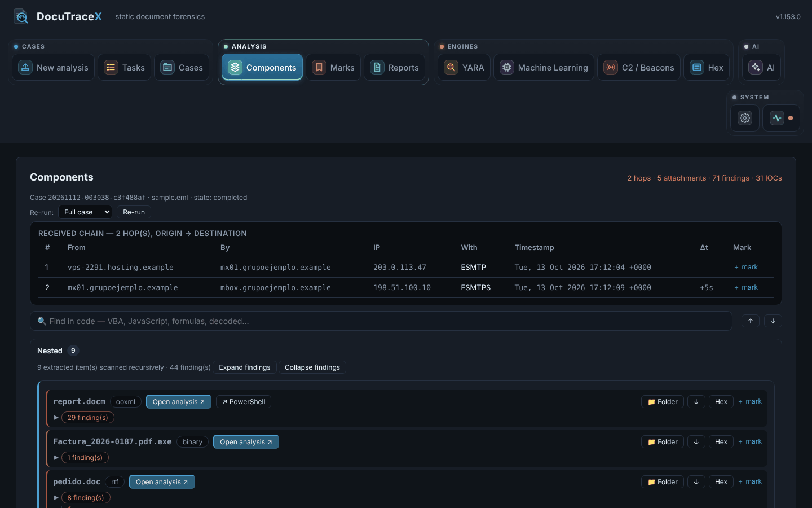

<div align="center">

# 📄🔎 DocuTraceX

**Static forensic analysis of malicious documents, emails, scripts and droppers — without opening them.**

Drop in a suspicious `.docm`, `.xlsm`, `.rtf`, `.pdf`, `.eml`/`.msg`, a `.js`/`.vbs`/`.ps1`/`.hta`,
a `.lnk`, an `.iso`/`.zip`/`.rar`, a OneNote, a `.jar`, an `.msi` or an `.exe` — even with no extension at all — open the browser, and
investigate: what the file really is, macros, DDE, remote templates and exploit objects, scripts
**deobfuscated and followed to their final behaviour**, email spoofing and look-alike domains,
packed binaries unpacked, payloads **pulled apart recursively**, IOCs you can **check on the
Internet through your proxy**, your own **YARA** rules, **C2 configurations** pulled out of implants, a machine-learning second opinion, triage
marks, a one-click report — and an **AI assistant / MCP server** that can read the case for you.
**Nothing in the sample is ever executed.**

-blue)


</div>

---

<p align="center">
  
</p>

<p align="center">
  <b>📚 Documentation: <a href="https://g92mz.github.io/DocuTraceX/">g92mz.github.io/DocuTraceX</a></b><br>
  <sub>what each file type shows, tab by tab, with screenshots</sub>
</p>

## 🚀 Quickstart

Python **3.10+ (64-bit)** with `pip`, on Windows, Linux or macOS. Only a light web service goes
on your Python; the analysis runs on a portable toolchain that `install.py` downloads into
`tools/`.

```bash
python install.py             # once: sets everything up (first start then asks for the admin password)
python run.py                 # every time: checks for updates (asks y/N), then starts → http://127.0.0.1:8000
```

<!-- rev: gmzpt -->

Every start of `python run.py` checks for a new version and asks before updating (`--no-update`
skips it; `python update.py` updates without starting), keeping your cases, rules, settings and
tools. Then set up the proxy, your own domains and brands: [Getting started](https://g92mz.github.io/DocuTraceX/getting-started/)
and [Configuration](https://g92mz.github.io/DocuTraceX/configuration/).

## ✨ What it does

- 🔍 **Type truth** — the real type of every file from its content, and extension mismatches.
- ✉️ **Email** — delivery path, SPF / DKIM / DMARC and Microsoft 365 stamps, the conversation chain and thread hijacks, look-alike domains, gateway-wrapped links decoded, HTML phishing and every attachment.
- 📝 **Office · PDF · RTF · OneNote** — macros extracted and emulated, Excel 4.0, DDE, remote templates, exploit objects, PDF actions and signatures, QR codes.
- 🧪 **Scripts** — JavaScript, PowerShell, VBScript, batch and Python deobfuscated and followed to their final behaviour, with MITRE ATT&CK.
- 🧱 **Binaries** — PE, .NET, Go, ELF and Mach-O: static triage, packers and installers unpacked, encrypted stages decrypted, functions and pseudocode, memory dumps carved.
- 🗝️ **Registry** — hives (whatever their name, with their transaction logs) and .reg exports loaded once into a per-case DuckDB database: browse with RECmd bookmarks, search, read-only SQL and a timeline; persistence, evasion and hiding rules; deleted keys and values recovered; artifacts decoded (UserAssist, ShimCache, BAM, ShellBags, USB…); the machine behind SYSTEM + SOFTWARE (users, time zone, install date); payloads in values carved; .reg and bodyfile exports. A full machine loads in about half a minute.
- 🪆 **Recursion** — everything a file carries is analysed in turn, many levels deep.
- 📡 **C2 · YARA · ML · Hex** — implant configurations, your rules, a machine-learning second opinion, a hex viewer.
- 🌐 **Network checks** — on demand, through your proxy, like a real victim with a fake identity.
- 🤖 **AI and MCP** — ask about a case through your AI provider, a local model or an MCP client (over HTTP with a token), read-only.
- 👥 **Users and audit** — sign-in for everyone, an admin who manages the accounts, and an audit trail of who ran, checked and marked what.
- 🏷️ **Triage and report** — mark findings and IOCs, export a self-contained HTML report.

<!-- rev: MH22fELbKP -->

## 🧪 Samples

`samples/samples.zip` (password **`infected`**) holds **benign** samples for every supported
type, all telling one invoice-fraud story with inert indicators (`*.example`, RFC 5737 IPs,
harmless stubs). See [`samples/README.md`](samples/README.md).

<!-- k: bhd1Sl5iFX -->

## 📝 Principles

- **Nothing runs for real.** No macro, script, link or attachment is executed by Office, a browser or the OS; emulators and sandboxes are isolated, with time limits.
- **Offline unless you ask.** The analysis never touches the network: only provisioning, the checks you launch and the AI endpoint you configure do.
- **Your data stays yours** in `cases/`, `yara/`, `config/` and `tools/`, all git-ignored and kept across updates.
- **Licences:** Apache-2.0, with no third-party GPL code shipped; optional GPL tools are installed separately and run as separate processes. See [`docs/TOOLS.md`](docs/TOOLS.md).

## 📜 License

Licensed under the **Apache License 2.0** — see [`LICENSE`](LICENSE) and `NOTICE`.

© 2026 Gregorio Moreno (**gmzpt**)
