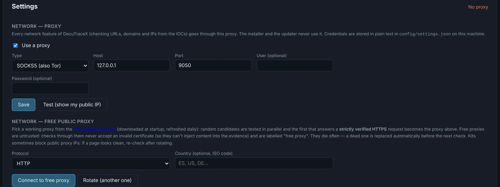
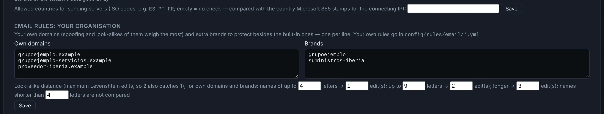

# Configuration

DocuTraceX works out of the box, but a few settings make it yours. Do them once after the first
start: they live in `config/` (`config/settings.json`, your rules in `config/rules/`, the users,
sessions, audit trail and MCP token) and survive updates.

Settings is one page in four groups, each a set of cards, with an index at the top to jump
between them (nothing is folded away):

| Group | Cards |
|---|---|
| **Network** | proxy, free public proxy, without a proxy, how URLs are checked, reference data (IP database, TLD list) |
| **Your organisation** | own domains, brands and look-alike distance; generic legitimate domains |
| **Email intelligence** | reputation lists (and the abuse.ch key), Microsoft 365 tenants, allowed countries |
| **Detection rules** | YARA rules, registry Sigma rules |

!!! tip "Ready in five minutes"
    1. **First start**: set the admin password, then create your colleagues' accounts in **Users**
       ([Users, sign-in and audit](users.md)).
    2. **Settings → Network → Proxy**: the proxy for network checks (or a free public one).
    3. **Settings → Your organisation**: your own domains and brands, and the providers you use so
       they are not reported as look-alikes.
    4. **Settings → Email intelligence**: optional keys and lookups.
    5. **Settings → Detection rules**: your **YARA** rules and, optionally, a folder of **Sigma**
       rules for the registry.
    6. **New analysis**: how many analyses run at once.
    7. Optional: the **AI** endpoint or **MCP**, and a look at **Diagnostics**.

## Network checks: the proxy

Nothing goes out until you press **Check** on an IOC, and then it goes through this proxy. The
installer and the updater never use it.

{ .shot }

- **Network — proxy**: tick *Use a proxy*, choose the type (HTTP, HTTPS, SOCKS4, SOCKS5 — Tor is
  SOCKS5 on `127.0.0.1:9050`), host, port and, if needed, user and password. **Test (show my
  public IP)** confirms where your checks will come from.
- **Network — free public proxy**: no proxy of your own? **Connect to free proxy** picks a working
  one from a public list (optionally from a country) and **Rotate** changes it. Free proxies are
  untrusted: checks through them never accept an invalid certificate and are labelled as such.
- **Without a proxy**, the first check asks once whether to go out from this machine's IP; **Ask
  again** (in this section) undoes that choice.

!!! warning "Credentials"
    The proxy password is stored in plain text in `config/settings.json` on this machine.

## Your organisation: own domains and brands

What turns a generic phishing check into *"someone is imitating us"*: spoofing of your own
domains and look-alikes of them weigh the most in the email verdict, and every domain of every
case is compared with them ([look-alike domains](file-types/email.md)).

{ .shot }

- **Own domains** — one per line: every domain you send mail from or that customers know, with
  their country and group variants. There is no limit; thousands stay fast.
- **Brands** — names to protect besides the built-in ones (Microsoft, DocuSign, banks, couriers…):
  your trade names, product names, the names of key suppliers.
- **Look-alike distance**: how many edits count as a look-alike, by name length (defaults: up to 4
  letters → 1 edit, up to 9 → 2, longer → 3; names under 4 letters are not compared). Raise it to
  catch more, lower it if short names produce noise.
- Your own **email rules** go in `config/rules/email/*.yml`: they add rules or override a built-in
  one by its id ([detection rules](detection-rules.md)).

## Generic legitimate domains

Providers that should never be reported as look-alikes of your domains or brands, without making
them your own (`outlook.office.com` is Microsoft's):

- **Services** — the whole domain belongs to the provider and is never compared;
- **Platforms** — anyone can pick the subdomain, so only that part is compared
  (`micros0ft-login.onmicrosoft.com` is still reported).

Add the SaaS and platforms your organisation uses; **Restore defaults** brings back the
built-in lists. Only the look-alike checks use them: every other rule still judges these domains.

## YARA rules

**Settings → Detection rules → YARA rules**: add **folders or files on this machine** (searched
recursively, read in place — a clone of a rule repository, your own rules) and / or **upload** rules
(`.yar`, `.zip`, `.tar.gz`). The card lists every source with a button to remove it, then press
**Recompile**: nothing compiles on its own. It shows the compiled rules (with a filter) and any
compile error per file. Scans run from the [YARA](engines/yara.md) tab — on a case, or on loose files.

## Registry: Sigma rules

A folder on this machine with Sigma rules — a clone of [SigmaHQ](https://github.com/SigmaHQ/sigma),
your own rules, or both, searched recursively. Nothing is downloaded: update the folder yourself
(`git pull`). **Save & scan** shows how many registry rules were loaded and lists the skipped ones
with why. The rules apply to the next analysis (or a re-run) of a case with hives or .reg files.

**Process filters**: some rules exclude the program that wrote the value (`Image` in a
`filter_*`). A hive does not record it, so by default those rules are skipped; tick the option to
run them with that filter not applied — more rules, more false positives, and their findings say so.
Rules that need a process field to match are always skipped.

## Email reputation lists and Microsoft 365

- **Email reputation lists** (free webmail, disposable domains, phishing domains and IPs, malware
  hosts) are compared locally — nothing is sent — and refreshed on start when older than a day. An
  optional **abuse.ch Auth-Key** (free) gets URLhaus directly.
- **Microsoft 365 tenants**: resolve the sender's tenant (`X-MS-Exchange-CrossTenant-Id`) with
  AZMap and Microsoft's public sign-in endpoints, and look the tenant up in tenant.fyi for every
  domain it has held. Only the tenant ID and the sender's domains are sent, never yours; answers
  are cached. Turn them off here if the analysis must stay fully offline.
- **Allowed countries** for sending servers (ISO codes, e.g. `ES PT FR`): a message whose
  connecting IP Microsoft 365 stamps with another country is flagged. Empty = no check.

## Analysis queue and time limits

- **New analysis → concurrency** (under the upload box): how many analyses run at once (1–8). More
  is faster on a big machine, but each analysis can start several tools.
- `DOCUTRACEX_TIMEOUT_FACTOR` (default **5**) multiplies every tool's time limit: on a slow machine
  or VM, a slow tool is better than a lost analysis.

## AI and MCP

- **YARA**: the rules are managed in **Settings → Detection rules** ([above](#yara-rules)); the
  [YARA](engines/yara.md) tab runs them.
- **AI**: the endpoint, model and key of your OpenAI-compatible API (a company LiteLLM, a provider)
  or of a local model (Ollama, LM Studio). The key stays in your browser.
- **MCP**: the **AI → MCP** tab has the configuration for Claude Desktop / Claude Code, and the
  command, URL and **token** to serve it over HTTP to other machines (OpenCode, Claude Code…):
  [MCP over HTTP and its token](engines/reports.md#mcp-over-http-and-its-token).

## Diagnostics

The **Diagnostics** tab checks every dependency, tool, database and the proxy.
A warning has a **Retry** button that reinstalls just that component; optional ones (the 459 MB
EMBER2024 family model, de4dot, ILSpy…) are installed only if you want them. See
[Tools and licences](TOOLS.md).
