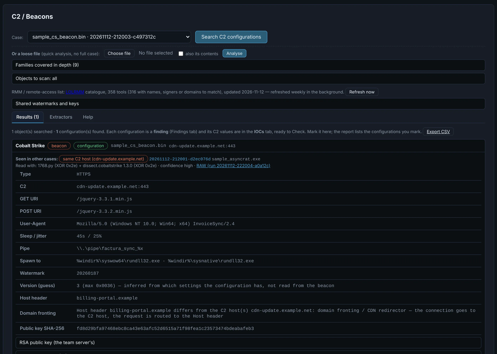
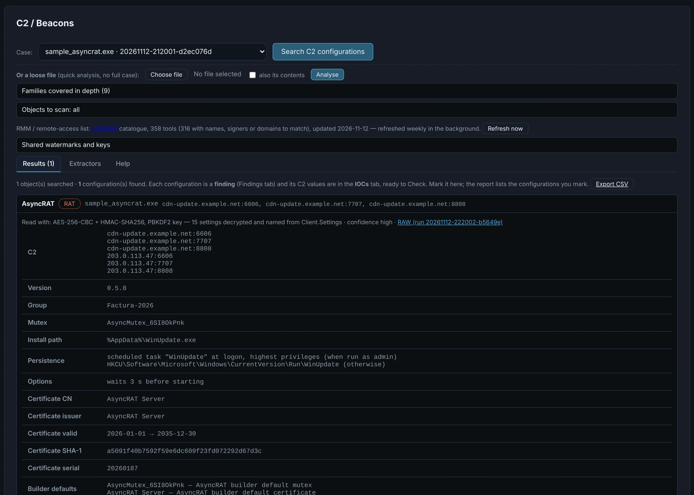

# C2 / Beacons

On demand: **Search C2 configurations** reads implant configurations out of **every object** of
the case — the original and everything extracted, unpacked, decrypted or carved — statically.

{ .shot }

## Families

| | |
|---|---|
| **Cobalt Strike** | beacons and stagers (HTTP/S, DNS, SMB / TCP peer-to-peer), PowerShell and VBA templates, Artifact Kit loaders, beacons embedded in loaders and dumps; a stager is told from Metasploit's by 1768.py's identification, the **license id** after its host, the Artifact Kit header or its short checksum8 URI. Read by **two parsers** (1768.py and dissect.cobaltstrike) and compared: C2, URIs, user agent, sleep, pipes, spawn-to, injection, evasion, guardrails, the team server's public key; known and shared watermarks labelled, never used as attribution |
| **Metasploit** | stagers (reverse HTTP/S, TCP) and exec payloads, also behind an encoder stub (shikata_ga_nai, x64/xor): only the stub runs, on an emulated CPU with no OS, and stops where the decoded payload starts |
| **RATs and stealers** | Remcos, AsyncRAT, DcRAT, VenomRAT, QuasarRAT, njRAT, XWorm, Warzone / AveMaria, AgentTesla, RedLine / META, Snake Keylogger, Raccoon v2, DarkGate, NanoCore — settings **named by their field** where the family has a settings class (also when a merged library's constants come first); **Quasar forks** that rename everything and hide the settings behind a decoder of their own (Quasar's message layer gives them away; the decoder is emulated); token grabbers that post to a **Discord webhook** (the webhook URL is the indicator) |
| **DarkCloud** | the VB6 stealer's string constants (BSTR pool) in the builder's order: **Telegram** bot token and chat id, **SMTP** server / port / SSL / account / recipient, **FTP**, the **panel** URL — a channel the buyer left off keeps its placeholder (`@StrSmtpUser`…) and is listed as not set; strings encrypted with **RC4 and a key per string** are decrypted first. A build in another order has its values named by their **shape** (an account and the value after it, an `smtp.` host, a port, True / False, an `ftp://` server, a URL) and a build with no version string nor placeholders is recognised by its **structure** (VB6, Telegram / CDO upload, keystrokes or clipboard and three more kinds of stolen data) — both at medium confidence. Also the version, the build ID, the install path and RunOnce persistence, the VB project path of the author's machine and what it steals |
| **Newer stealers** | **StealC** (C2 and its `/<16 hex>.php` gate; **v2** with its JSON protocol and the tasks it accepts, also when the RC4 key is not stored as text — the shared keystream is recovered from the strings every build carries — and with the C2 written as one number) and **Vidar** (its Telegram / Steam **dead drops**, from strings protected with base64 + RC4 like Raccoon v2 or kept in clear next to the build's markers); **Lumma** (each C2 domain base64 with its own 32-byte XOR key, the Steam / Telegram fallback; ChaCha20 or flattened builds give traces only) |
| **Post-exploitation** | **Brute Ratel C4** badgers (base64 + RC4 configuration, the builder's default key first): hosts, port, URIs, user agent; **Havoc** Demon (the configuration buffer of an unencrypted build): sleep / jitter, injection, spawn-to, kill date, working hours, hosts and ports, TLS, user agent, headers, URIs, proxy |
| **Pure family** | PureCrypter / PureLogs / PureHVNC / PureRAT (.NET): settings as protobuf, GZip-compressed and base64, read with a generic protobuf reader — C2 host:port and the numbered fields |
| **Go implants** | Sliver, Merlin, Mythic agents, or generic: framework and endpoints with where each came from |
| **RMM tools** | ScreenConnect, AnyDesk, Atera, NetSupport… (~360 from the [LOLRMM](https://lolrmm.io) catalogue), with the relay, account or gateway an installer binds them to. Each detection lists what matched (file name, signer, domain, description) with the text around it and its offset; a signer that signs far more than remote-access tools (Adobe, Microsoft…) is never enough on its own. Registry hives and `.reg` files are left to the [Registry rules](../file-types/registry.md), which say the key and value |

{ .shot }

Each configuration says whether it is complete, partial or only **indicators**, and why
(protected, encrypted with an unknown key…). Each one is a finding, its C2 values join the
IOCs, configurations that share a C2 host, public key or watermark with other cases are linked,
and the ones you mark go to the report and the CSV export. The raw output of every tool is kept
per run and can be **re-interpreted** without running anything again.

**Where static analysis stops**, the tab says so first, in a banner that cannot be missed: the
**final payload** of a known family was reached but its configuration is encrypted with a scheme
no extractor reads (Formbook / XLoader…), or a **loader** still carries its payload encrypted (a
large high-entropy section or resource, a Go loader's data) and nothing below it was opened.
Each entry says what to do in a sandbox — watch the traffic, or dump the unpacked process and
upload the dump here — and what to watch for: decoy domains, dead drops, the virtual-machine
checks it makes. Finding `c2:dynamic_analysis`.

The **Families** section has a card for every family an extractor knows — what it is, how it arrives, what is read, what to do next and its limits; **Extractors** lists every
extractor with its version, formats and the result of the run. Details of the third-party
parsers: [C2 external parsers](../c2-external-parsers.md).
