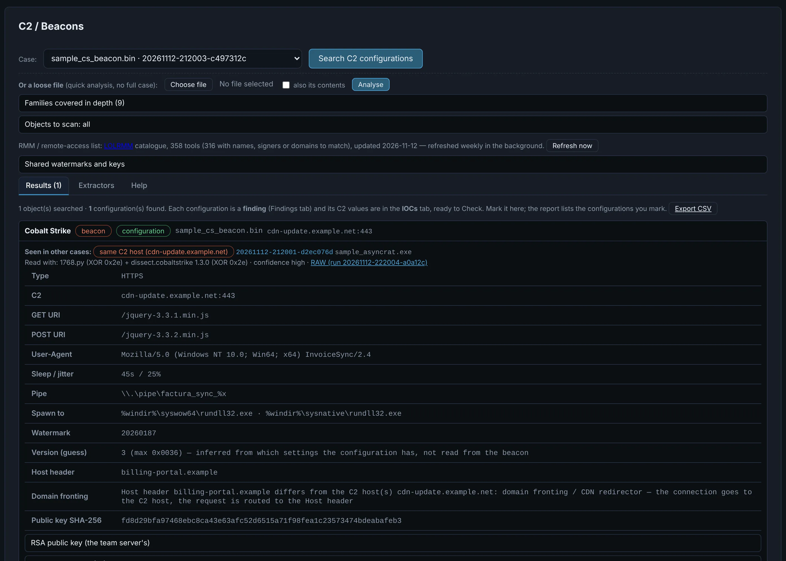
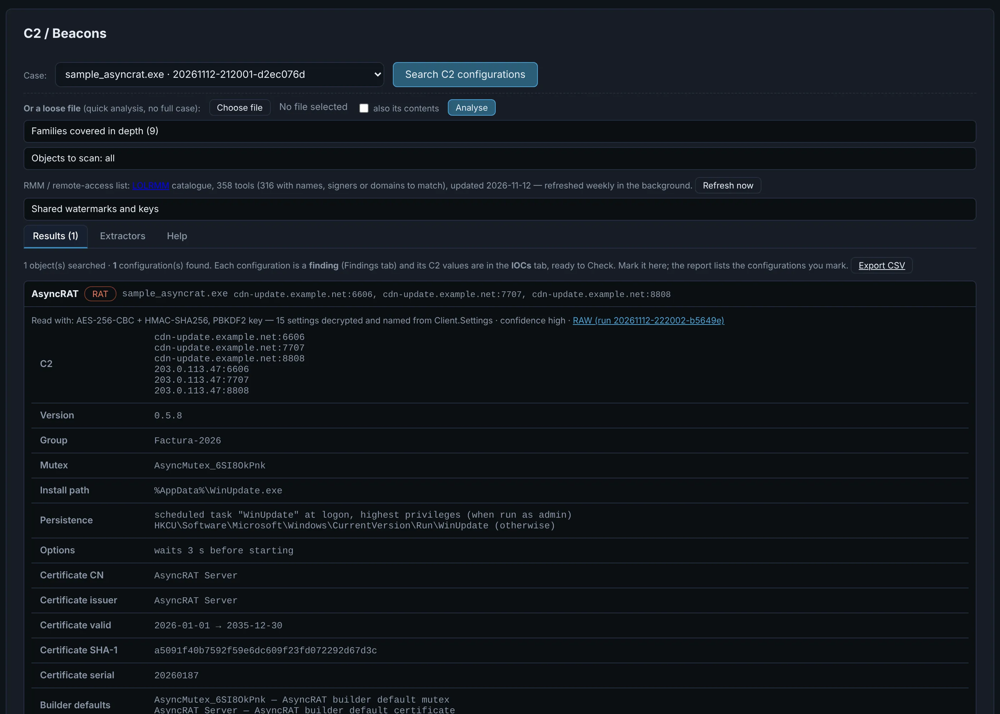

# C2 / Beacons

On demand: **Search C2 configurations** reads implant configurations out of **every object** of
the case — the original and everything extracted, unpacked, decrypted or carved — statically.

{ .shot }

## Families

| | |
|---|---|
| **Cobalt Strike** | beacons and stagers (HTTP/S, DNS, SMB / TCP peer-to-peer), PowerShell and VBA templates, Artifact Kit loaders, beacons embedded in loaders and dumps. Read by **two parsers** (1768.py and dissect.cobaltstrike) and compared: C2, URIs, user agent, sleep, pipes, spawn-to, injection, evasion, guardrails, the team server's public key; known and shared watermarks labelled, never used as attribution |
| **Metasploit** | stagers (reverse HTTP/S, TCP) and exec payloads |
| **RATs and stealers** | Remcos, AsyncRAT, DcRAT, VenomRAT, QuasarRAT, njRAT, XWorm, Warzone / AveMaria, AgentTesla, RedLine / META, Snake Keylogger, Raccoon v2, DarkGate, NanoCore — settings **named by their field** where the family has a settings class |
| **Go implants** | Sliver, Merlin, Mythic agents, or generic: framework and endpoints with where each came from |
| **RMM tools** | ScreenConnect, AnyDesk, Atera, NetSupport… (~360 from the [LOLRMM](https://lolrmm.io) catalogue), with the relay, account or gateway an installer binds them to |

{ .shot }

Each configuration says whether it is complete, partial or only **indicators**, and why
(protected, encrypted with an unknown key…). Each one is a finding, its C2 values join the
IOCs, configurations that share a C2 host, public key or watermark with other cases are linked,
and the ones you mark go to the report and the CSV export. The raw output of every tool is kept
per run and can be **re-interpreted** without running anything again.

The **Families** section describes each family covered in depth; **Extractors** lists every
extractor with its version, formats and the result of the run. Details of the third-party
parsers: [C2 external parsers](../c2-external-parsers.md).
