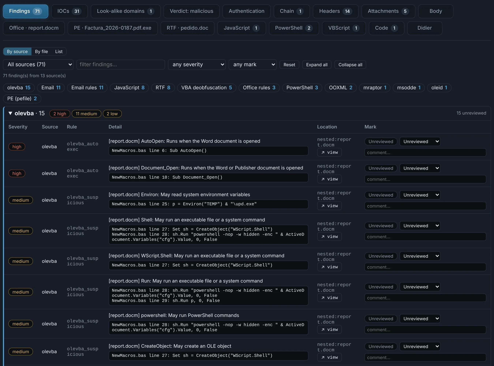
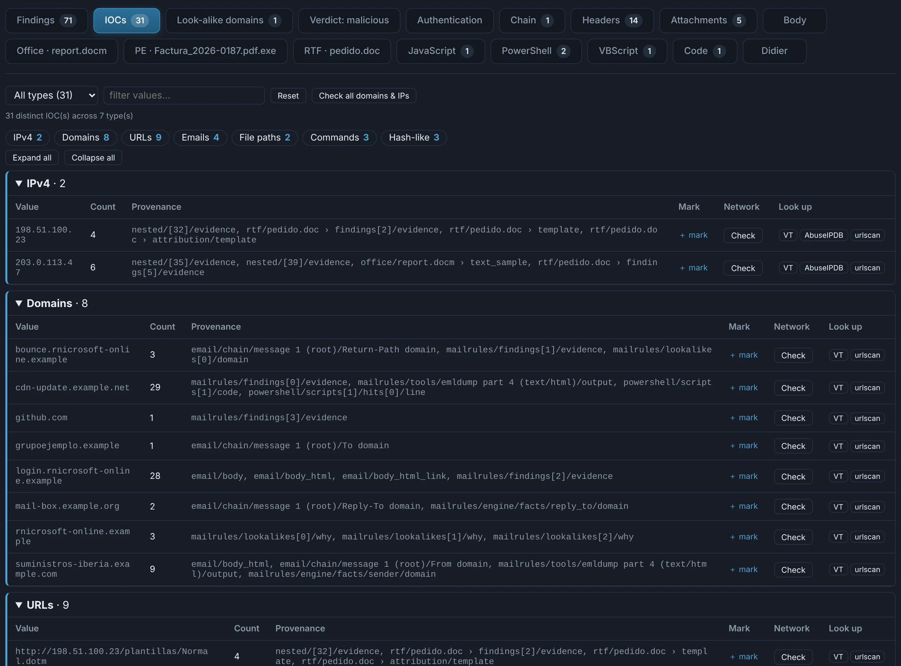

# Findings, IOCs and marks

Every case, whatever the file type, has the same backbone.

## Findings

What every analyser found — the file type's own analysis, the rules and every tool that looked
at a nested object — with its severity, evidence and location (and a **↗ view** jump to it).
Group them **by source**, **by file** or as a **list**, filter by severity, source or mark.

{ .shot }

## IOCs

URLs, domains, IPs, email addresses, file paths, registry keys, named pipes, mutexes, commands
and hashes, from the content of every analysis, each with its **provenance** (which part of
which file). They are **filtered for noise**: what the tools print about themselves, OIDs,
library names that look like domains, the analysis' own paths. IOCs that belong to an RMM tool
carry a badge.

{ .shot }

**Check** visits one through your proxy ([network checks](network-checks.md)); **VT** and
**urlscan** open a search in your browser — nothing is sent from the server.

## Nested

Everything a file carries — attachments, archive entries, embedded objects, unpacked binaries,
decrypted stages, files hidden in images, objects carved from memory — is analysed **in turn**,
many levels deep, each with the **recipe** that produced it (`base64 → xor(0x23) → gzip`…).
**Open analysis ↗** opens any child like a case of its own, with all its tabs.

Nested opens as a **tree that grows to the right**: each level is a column, and each line takes
the colour of the worst finding in that branch, so the dangerous path stands out. Only the
branches that lead to findings start open; **▸** opens or closes any other branch. Long runs of
noise each fold into one grey box that opens on demand:

- the MSI's own tables;
- files that were only listed (a Python standard library);
- clean resources and icons.

The tree sits in a large window. Drag or use the wheel to move it, **Ctrl + wheel** (or a pinch)
to zoom, and **Fit** / **1:1** / **Full screen** to change how much of it you see. Clicking a box
shows its findings, origin and recipe beside the tree. **List** brings back the classic list, which
has the marks and the file actions.

## Marks

Mark any finding **TP / FP / Suspicious / Informational** with a comment, and any IOC or item
with **+ mark**. Marks survive re-analysis, and the [report](reports.md) is built from what you
confirmed.
