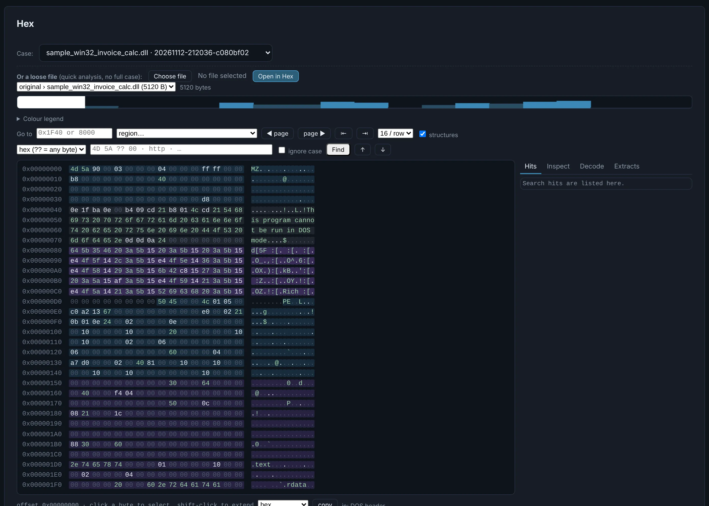

# Hex

A hex viewer for every file of the case, opened from any **Hex** button at the right offset.

{ .shot }

- **Structures** coloured and listed (PE headers, sections, directories, .NET metadata, ZIP
  records…), with an **entropy strip** and its legend.
- **Search**: hex with wildcards (`4D 5A ?? 00`), text, regex.
- **Inspect** the selected bytes (integers, timestamps, GUIDs…), **copy as** hex, C, Python…
- **Decode** the selection with a recipe (`base64 | zlib`, `xor 696e76`…) and **extract it as a
  nested child** of the case: it is analysed like any other object.
