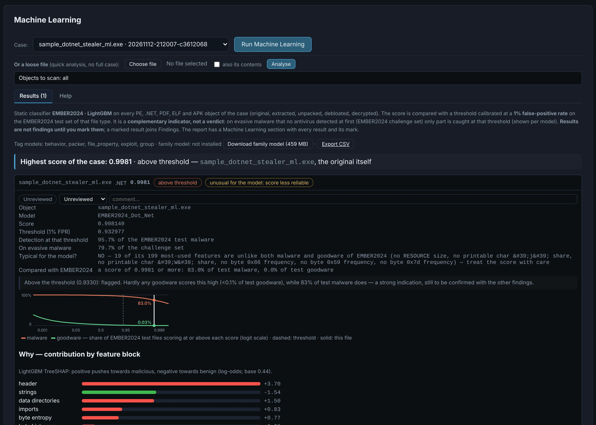

# Machine Learning

On demand, the **EMBER2024** static classifiers (Apache-2.0) score every PE, .NET, PDF, ELF and
APK object of the case against a threshold calibrated at a **1 % false-positive rate**, with
family and behaviour hints.

{ .shot }

Each result explains itself: where the score stands against EMBER2024's test malware and
goodware, whether the file is **typical for the model** (a score on an unusual file is less
reliable), and **why** — the feature blocks and features that pushed the score, in plain words,
with a jump to the bytes in the [Hex](hex.md) viewer.

!!! warning "A second opinion, not a verdict"
    Results become findings only once you mark them.
