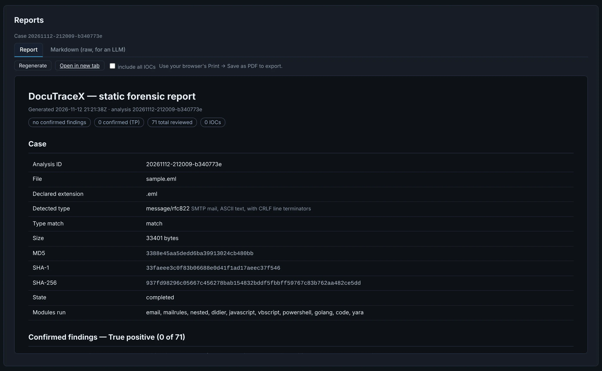

# Reports, AI and MCP

## Report

One self-contained HTML report of what you **confirmed**: file hashes, the findings you marked
true positive with their evidence, the IOCs and C2 configurations you marked (or every IOC),
the nested tree and the Machine Learning results. Print it to PDF or attach it to a ticket.

{ .shot }

**Markdown (raw, for an LLM)** has one sub-tab per part of the analysis — summary, findings,
IOCs, stages, decrypted data, code, .NET, ML, C2, network checks, every module's raw JSON —
each with **Copy** and **Download**: paste it into any model or a ticket.

## AI and MCP

The **AI** tab answers questions about a case ("is this phishing? what would the macro do?")
with real data from it, through any **OpenAI-compatible endpoint** (your company's LiteLLM, a
provider), a **local model** (Ollama, LM Studio…), or an **MCP client** (Claude Desktop, Claude
Code) connected to `python -m docutracex.mcp_server`. The tab shows the exact configuration for
your installation.

### Connecting an MCP client

The **AI → MCP** tab shows every command below already filled in with your installation's paths
(the portable Python, the app folder and the cases folder), ready to copy.

=== "stdio (same machine)"

    The client starts the server itself. Claude Desktop: *Settings → Developer → Edit Config*
    and paste the `mcpServers` block from the tab. Claude Code:

    ```bash
    claude mcp add docutracex -e PYTHONPATH=<DocuTraceX> -e DOCUTRACEX_CASES_DIR=<DocuTraceX>/cases -- <python> -m docutracex.mcp_server
    ```

=== "HTTP (other machines, HTTP-only apps)"

    Start the server and leave it running; clients connect to `http://<this machine>:8001/mcp`
    (MCP *streamable HTTP*).

    ```powershell
    # Windows (PowerShell), from any folder
    $env:PYTHONPATH="<DocuTraceX>"; $env:DOCUTRACEX_CASES_DIR="<DocuTraceX>\cases"
    & "<DocuTraceX>\tools\python\python.exe" -m docutracex.mcp_server --http --host 0.0.0.0 --port 8001
    ```

    ```bash
    # Linux / macOS
    PYTHONPATH=<DocuTraceX> DOCUTRACEX_CASES_DIR=<DocuTraceX>/cases \
      <DocuTraceX>/tools/python/bin/python3 -m docutracex.mcp_server --http --host 0.0.0.0 --port 8001
    ```

    Then, in the client, add a server of type **HTTP** with that URL — for Claude Code:
    `claude mcp add --transport http docutracex http://<this machine>:8001/mcp`.

    `--host 0.0.0.0` listens on every interface and accepts connections by IP or host name
    (the SDK's DNS-rebinding check is turned off for that); `--host 127.0.0.1` (the default)
    keeps it on this machine.

    !!! warning "No authentication"
        Anyone who reaches the port can read your cases (read-only). Open it only on a network
        you trust — a firewall rule for your analysis machines, or a VPN.

All of them use the same **read-only** tools: case summary, findings with your marks, IOCs, any
analysis result, functions and their pseudocode, decrypted data, the nested tree, ML results and
network checks. None can modify a case or reach the network; the endpoint is only called when
you ask, and its key stays in your browser.
