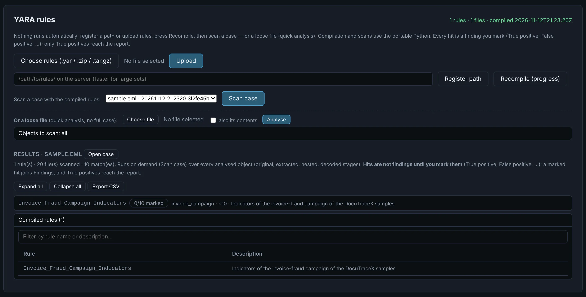

# YARA

Your rules — folders on this machine and / or uploaded `.yar`, `.zip` or `.tar.gz`, managed in
[Settings → Detection rules → YARA rules](../configuration.md#yara-rules) — compiled once and run
**on demand** on every object of the case — or on the objects you tick. A hit is not a finding until you mark it; matches export to
CSV.

{ .shot }

Analyses start only from **New analysis**: next to *Analyze*, choose *Full analysis (all engines)*
(the standard analysis plus YARA, Machine Learning and C2 / Beacons), *Standard analysis* (those
three stay on demand), or a single engine (*YARA only*, *Machine Learning only*, *C2 / Beacons only*, *Hex only*). A single engine
opens a **quick case** per file (marked in the case lists), shown in that engine's tab; the files
run as many at a time as *Analyze at a time* allows — the rest wait in the queue (Tasks tab). With
*also its contents*, each file's full analysis runs first and the engine after it. The YARA,
Machine Learning, C2 and Hex tabs pick a case to show (and can re-run their engine on it).
