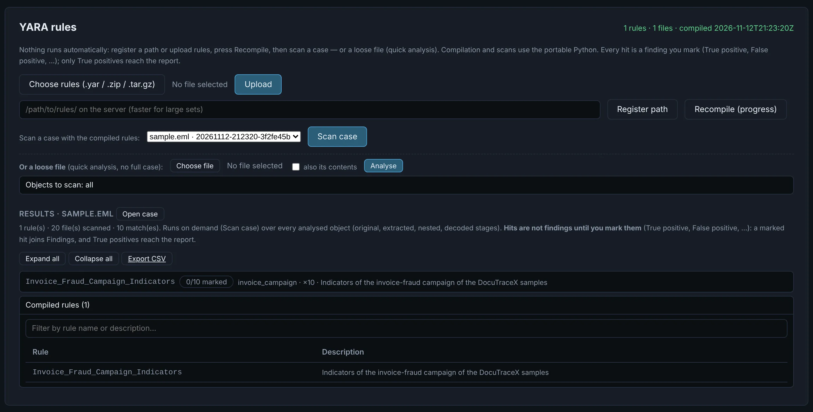

# YARA

Your rules — folders on this machine and / or uploaded `.yar`, `.zip` or `.tar.gz`, managed in
[Settings → Detection rules → YARA rules](../configuration.md#yara-rules) — compiled once and run
**on demand** on every object of the case — or on the objects you tick. A hit is not a finding until you mark it; matches export to
CSV.

{ .shot }

YARA, Machine Learning, C2 and Hex also take a **loose file** without a full case. YARA,
Machine Learning and C2 take **several files at once**: each becomes a quick case (marked in the
case lists), and they run as many at a time as *Analyze at a time* in New analysis allows — the
rest wait in the queue (Tasks tab). With *also its contents*, each file's full analysis runs
first and the engine after it.
