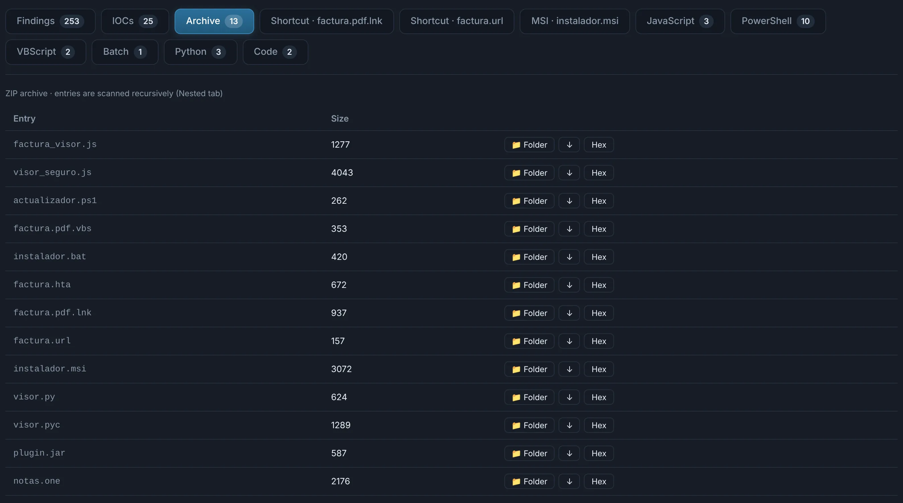
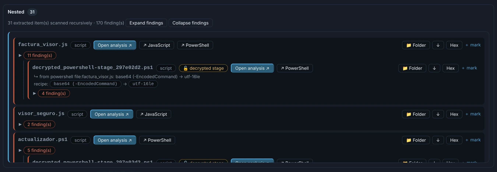
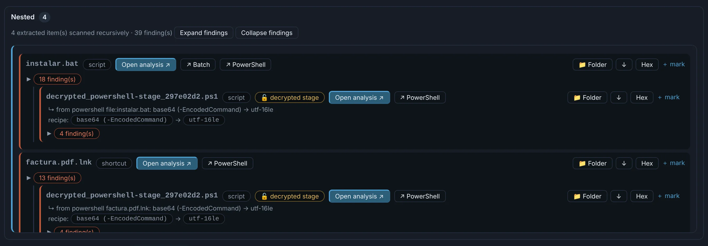

# Archives and disk images

ZIP, 7z and RAR (password-protected too), tar / gz / bz2 / xz, CAB and ISO / IMG / UDF images —
and any other format 7-Zip reads, **found by content** even without an extension or behind
junk. Extraction is safe: limits on depth, number of files and size stop archive bombs.

The **Archive** tab lists the entries with their size, detected type and SHA-256. Every entry is
analysed in turn in **Nested**: a ZIP of scripts becomes a tree of deobfuscated scripts, an ISO
with a `.lnk` and a `.bat` (the Mark-of-the-Web bypass) shows both with what they would run.

{ .shot }

{ .shot }

{ .shot }

**Portable interpreters.** An archive (or an installer, see *Installers*) that brings its own
interpreter — the embeddable Python (`pythonw.exe` + `python3XX._pth` / `.zip` / `.dll`),
`node.exe`, a private JRE (`javaw.exe` + `jvm.dll`), `AutoIt3.exe`, AutoHotkey, portable Ruby,
Perl, PHP, Lua, Tcl, PowerShell 7… — is reported as an **embedded *language* interpreter**, with
its runtime files, the scripts it can run and the files in the bundle that launch it. High when it
runs without a window, a launcher in the bundle starts it, or what it is given does not look like
that language (`node.exe readme.txt`, `pythonw.exe notas.html`).

**DLL side-loading.** A program next to a DLL with the name of a Windows system library
(`version.dll`, `winhttp.dll`, `dbghelp.dll`, `uxtheme.dll`…) in the same folder of an archive or
disk image loads that DLL instead of the one in System32 — the delivery of Bumblebee, PlugX,
Latrodectus and many loaders. *dll_sideloading* (T1574.002) is **high** when the program imports
that library and the pair does not hold together: the program is signed and the DLL is not, the
DLL has another signer, or the DLL is a **proxy** that forwards its exports to the real library
(`C:\Windows\System32\version.GetFileVersionInfoW`) and adds its own. A copy signed by Microsoft
(a redistributable `dbghelp.dll`, `d3dcompiler`…) is low. Signatures are read for their names,
not verified.

!!! tip "Passwords"
    An encrypted archive is opened with the password you give, a password **the carrying email
    states** (in many languages: *"la contraseña es…"*), or the usual defaults (`infected`…).
    Nothing is brute-forced.
