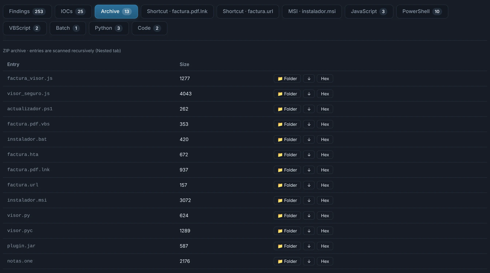
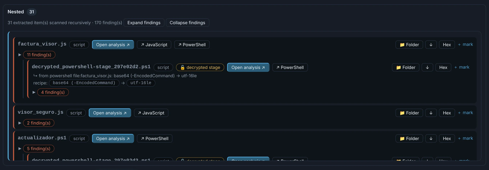
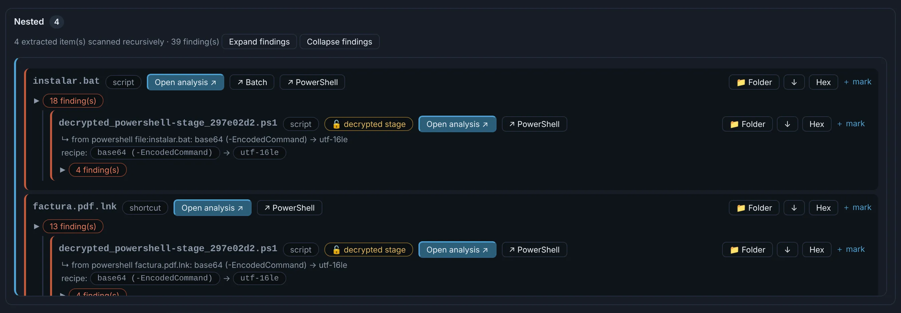

# Archives and disk images

ZIP, 7z and RAR (password-protected too), tar / gz / bz2 / xz, CAB and ISO / IMG / UDF images —
and any other format 7-Zip reads, **found by content** even without an extension or behind
junk. Extraction is safe: limits on depth, number of files and size stop archive bombs.

The **Archive** tab lists the entries with their size, detected type and SHA-256. Every entry is
analysed in turn in **Nested**: a ZIP of scripts becomes a tree of deobfuscated scripts, an ISO
with a `.lnk` and a `.bat` (the Mark-of-the-Web bypass) shows both with what they would run.

{ .shot }

{ .shot }

{ .shot }

!!! tip "Passwords"
    An encrypted archive is opened with the password you give, a password **the carrying email
    states** (in many languages: *"la contraseña es…"*), or the usual defaults (`infected`…).
    Nothing is brute-forced.
