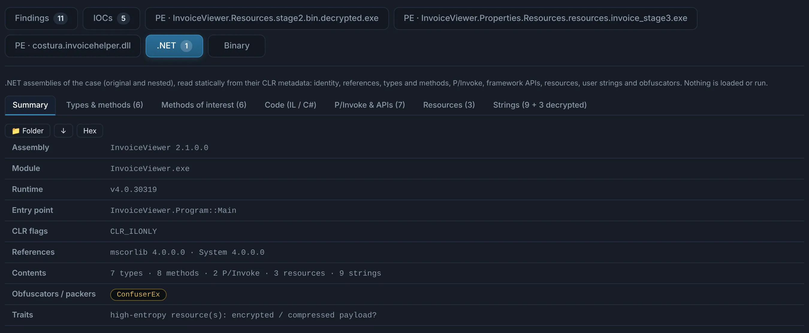
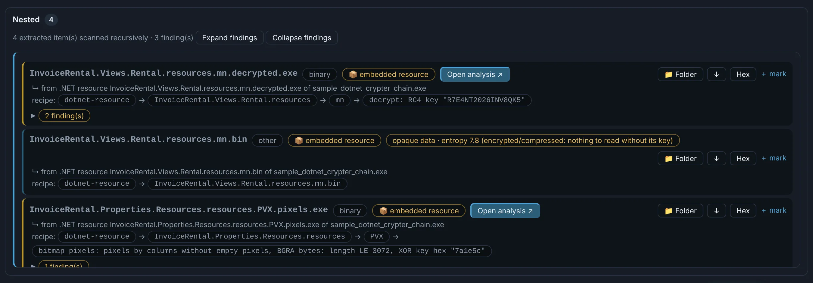

# .NET

Managed assemblies get their own **.NET** tab on top of the [PE triage](windows-pe.md). Their
code is CIL: it is disassembled and read, never run.

??? abstract ".NET — identity, code of interest, strings and resources"

    - **Identity**: assembly name and version, runtime, entry point, references, and the
      **obfuscator** that protected it (ConfuserEx, .NET Reactor, SmartAssembly, KoiVM…).
    - **P/Invoke** native APIs (`VirtualAlloc` + `CreateThread`: shellcode loading) and the
      framework APIs it uses (`WebClient`, `Assembly.Load`, `RegistryKey`, cryptography).
    - **Methods of interest**: the loader, network and persistence methods first, each with its
      calls, literals and static arrays — and **C# on demand** (ILSpy, after a de4dot clean-up of
      names and control flow when it was obfuscated).
    - **Strings decrypted statically**: the assembly's own decryptors (XOR, AES, DES, RC4,
      Base64 chains) are recognised and applied to its literals and static arrays, with the
      routine and key that did it.
    - **Resources**: `.resources` files opened entry by entry; encrypted entries decrypted with
      the keys the assembly holds (in the method, its class or the whole assembly), and images
      read pixel by pixel.

    { .shot }

## Crypters: following the stages

Many .NET loaders are layers of a crypter: stage 2 hidden in an encrypted resource, stage 3
in the pixels of a Bitmap, the final payload behind them. Each stage DocuTraceX decrypts is a
nested child, analysed again as .NET — and the [C2](../engines/c2.md) tab reads the
implant's configuration from the last one.

{ .shot }

!!! note "When a stage cannot be decrypted statically"
    Virtualised or heavily protected code (KoiVM, .NET Reactor with string encryption,
    ConfuserEx constants) keeps its secrets until it runs. Dump the process in your lab VM and
    analyse the [memory dump](memdump.md): the stage is there in clear.
