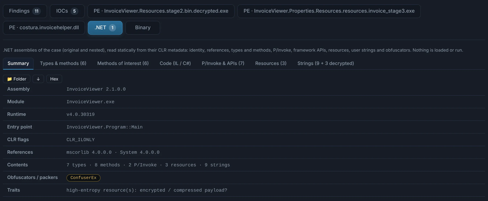
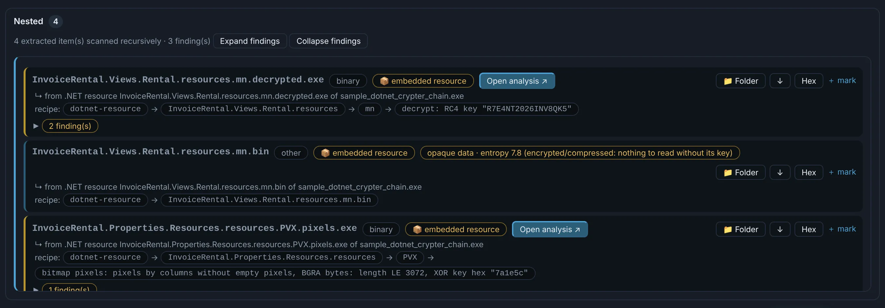

# .NET

Managed assemblies get their own **.NET** tab on top of the [PE triage](windows-pe.md). Their
code is CIL: it is disassembled and read, never run.

??? abstract ".NET — identity, code of interest, strings and resources"

    - **Identity**: assembly name and version, runtime, entry point, references, and the
      **obfuscator** that protected it (ConfuserEx, .NET Reactor, SmartAssembly, KoiVM…).
    - **P/Invoke** native APIs (`VirtualAlloc` + `CreateThread`: shellcode loading) and the
      framework APIs it uses (`WebClient`, `Assembly.Load`, `RegistryKey`, cryptography).
    - **Methods of interest**: the loader, network and persistence methods first, each with its
      calls, literals and static arrays — and **C# on demand** (ILSpy, after a de4dot clean-up of
      names and control flow when it was obfuscated).
    - **Strings decrypted statically**: the assembly's own decryptors (XOR, AES, DES, RC4,
      Base64 chains) are recognised and applied to its literals and static arrays, with the
      routine and key that did it.
    - **ConfuserEx constants**: the literals ConfuserEx moves into its encrypted array come
      back. The usual (Normal mode) layout is read by its pattern; **mutated builds** —
      control flow flattened into a `switch`, the key derivation inlined in `<Module>.cctor`,
      jumps between the id and the getter call — are handled by **emulating the CIL**: the
      module initializer and the getters run on a model of the runtime (stack, arrays,
      static fields, `Buffer.BlockCopy`, `Encoding.GetString`, `MemoryStream`…; LZMA answered
      natively), never on the machine — reflection, `AppDomain` and P/Invoke answer *unknown*,
      and step / time budgets bound it. Getters with no call site of their own — reached
      through a **reference proxy** (a proxy method, a delegate made with `ldftn`,
      `Module.ResolveMethod` / `Delegate.CreateDelegate`) — are caught as they return: every
      method is run once and what a decoder hands back on the way is kept. An assembly the
      module `Assembly.Load`s at start (ConfuserEx's embedded resources / compressor) becomes a
      Nested child, and so does a **payload kept in the constants**: a base64 file, or one the
      other constants open (3DES / AES with a base64 key and IV, as the DarkCloud chain's
      injector keeps the stealer).
    - **Obfuscators of their own**: the same emulation runs when the literals read as encoded
      text (no spaces, many symbols, long runs of capitals) or when an assembly with almost no
      literals reads a resource, decrypts it and turns bytes into text (a .NET Reactor-like
      **string table**): the class initializers run on first use, the decoders the assembly
      calls are caught as they return (*string decoder (CIL emulation)*), with `List` /
      `Dictionary`, `BinaryReader`, the manifest resources and the framework's AES / DES /
      3DES, MD5 / SHA and PBKDF2 modelled.
    - **Resources**: `.resources` files opened entry by entry; encrypted entries decrypted with
      the keys the assembly holds (in the method, its class or the whole assembly), and images
      read pixel by pixel.

    { .shot }

## Crypters: following the stages

Many .NET loaders are layers of a crypter: stage 2 hidden in an encrypted resource, stage 3
in the pixels of a Bitmap, the final payload behind them. Each stage DocuTraceX decrypts is a
nested child, analysed again as .NET — and the [C2](../engines/c2.md) tab reads the
implant's configuration from the last one.

{ .shot }

!!! note "When a stage cannot be decrypted statically"
    Virtualised or heavily protected code (KoiVM, .NET Reactor with string encryption,
    ConfuserEx's Dynamic / x86 constants modes, its anti-tamper) keeps its secrets until it runs. Dump the process in your lab VM and
    analyse the [memory dump](memdump.md): the stage is there in clear.
