# Email

`.eml`, `.emlx` and `.msg` (Outlook). An email is usually where an investigation starts: who
really sent it, how it travelled, whether its authentication holds, what it asks the reader to
do, and what it carries. DocuTraceX answers each of those in its own tab, and analyses every
attachment and link target as a case of its own.

## Delivery path and attachments

At the top of every email case: the **Received chain**, from origin to destination, with the IP,
protocol and time of each hop and the delay between hops. Below it, **Nested** lists everything
the email carries — attachments, the objects inside them, unpacked binaries, decoded stages —
each analysed with its own family's tools, many levels deep.

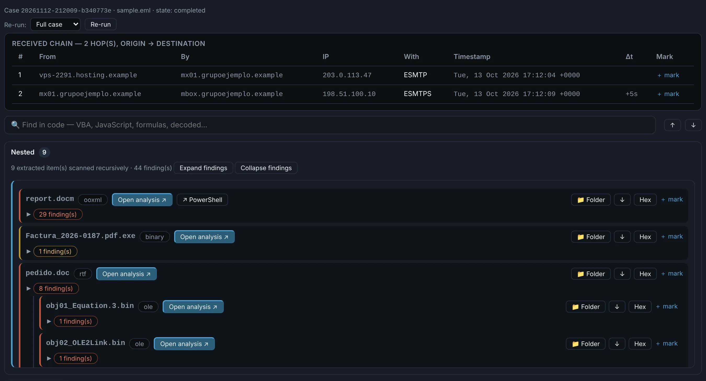{ .shot }

- **Open analysis ↗** opens any child like a case of its own, with all its tabs.
- Each child shows its findings, a **Folder** / **↓** download, a jump to the **Hex** viewer, and
  a **mark** for the report.

## Tabs

??? abstract "Verdict — why this email is suspicious, signal by signal"

    A score built from every email signal, with the thresholds that turn it into *clean*,
    *suspicious*, *phishing* or *malicious*. Each signal says what raised it and how much, so the
    verdict can be argued, not just trusted.

    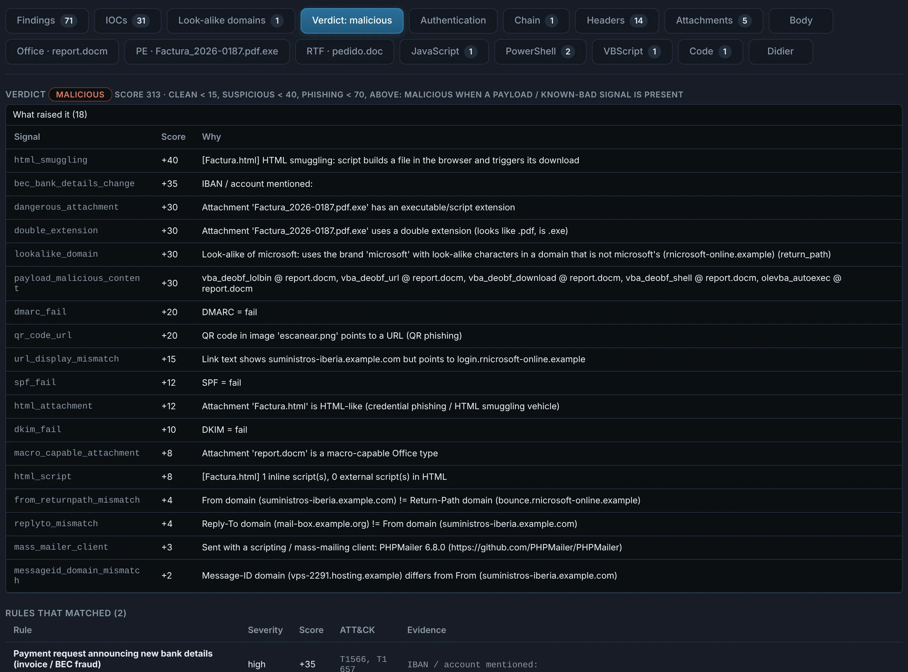{ .shot }

    Signals include failed SPF / DKIM / DMARC, a look-alike domain, a Reply-To or Return-Path that
    goes elsewhere, dangerous or double-extension attachments, HTML smuggling, a QR code that
    points to a URL, link text that shows one site and points to another, a change of bank
    details, mass-mailing clients and malicious content found in the attachments.

??? abstract "Authentication — SPF, DKIM, DMARC, the sender and Microsoft 365"

    **What the receiving servers concluded**, as stamped in `Authentication-Results`, next to who
    the message claims to come from:

    - **SPF / DKIM / DMARC** results, and whether a DKIM signature is present. When the DKIM
      *body hash* does not match, the body was **edited after signing**.
    - **Sender / routing**: From and its display name, Return-Path, Reply-To, Message-ID, Date
      and the sending client.
    - **Look-alike domains** in the sender, the return path and the links.
    - A **sender fingerprint** (client, infrastructure).

    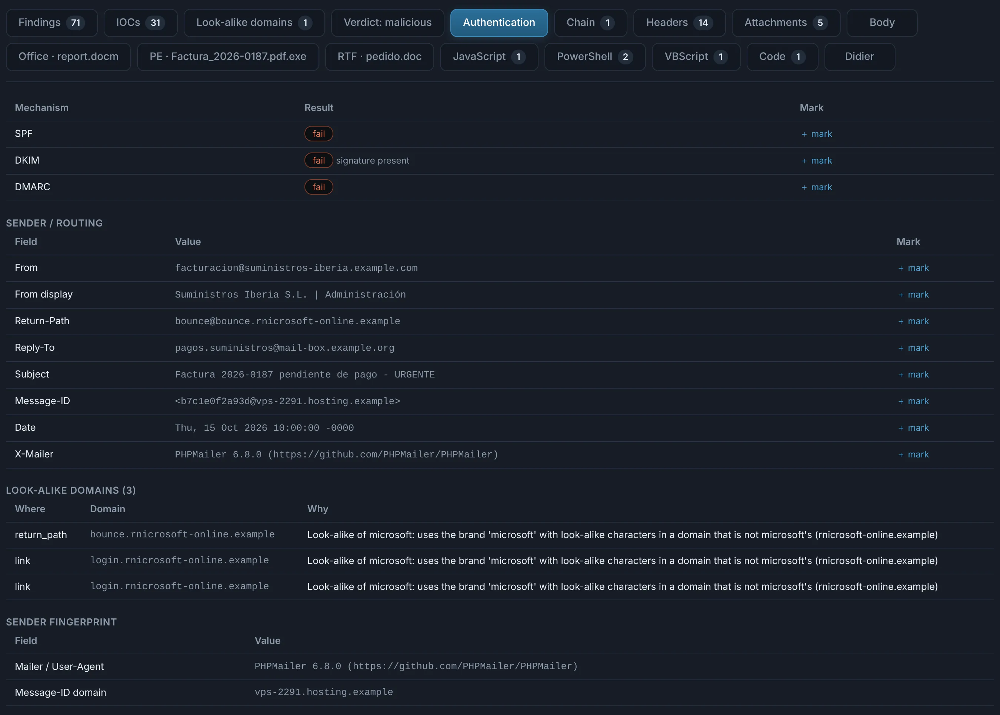{ .shot }

    !!! note "Stated, not re-checked"
        SPF / DKIM / DMARC are read from the headers the receiving servers wrote; DocuTraceX does
        not query DNS to re-check them (the analysis is offline). The DKIM body hash is checked
        locally.

    **Microsoft 365 / Exchange Online.** When the message went through Exchange Online, its
    anti-spam stamps are decoded into plain words: the policy applied (`CAT`), the spam verdict
    (`SFV`), the safety tip (`SFTY`), composite authentication (`compauth` and its reason), the
    DMARC action, the connecting IP and country, and the sender's tenant.

    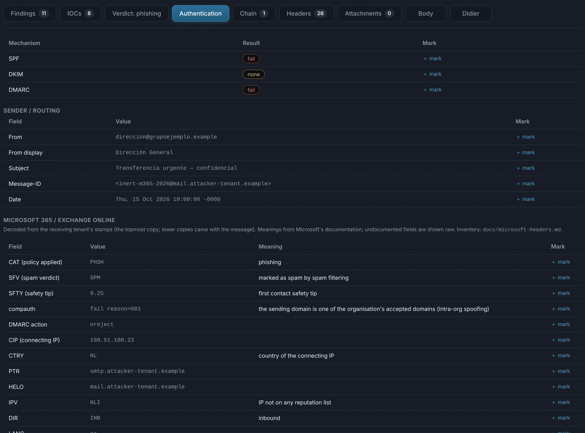{ .shot }

    Every field, its meaning and its source: [Microsoft 365 headers](../microsoft-headers.md).

??? abstract "Chain — the conversation, message by message"

    The conversation as the file shows it: the message itself, the messages **attached** to it
    and the ones **quoted** in its body (in English and Spanish reply formats, with or without
    display names), oldest first. Each message is compared with the previous one, and the
    changes are coloured: **new**, **removed**, **moved / changed** participants, subjects and
    dates.

    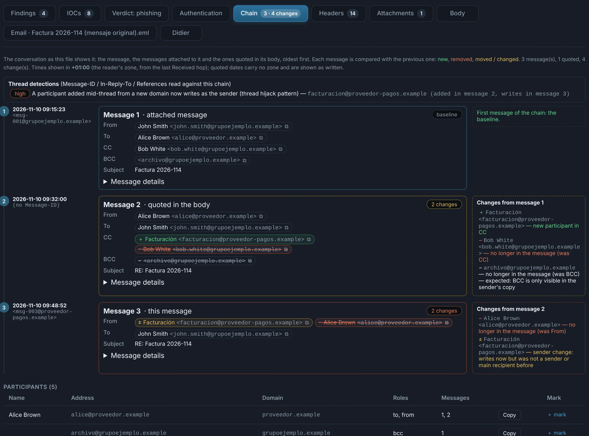{ .shot }

    - **Thread detections** read Message-ID / In-Reply-To / References against the chain. The
      classic one is the **thread hijack**: a participant added mid-thread from a new domain who
      later writes as the sender.
    - Times are shown in the reader's zone (taken from the last Received hop); quoted dates carry
      no zone and are shown as written.
    - A quoted or attached message is never complete — the tab works with what is there and
      does not flag what a thread cannot have.

??? abstract "Headers — every header, raw"

    All the headers, in order, exactly as they are in the file, each one markable for the
    report. Useful to read what the other tabs summarise.

    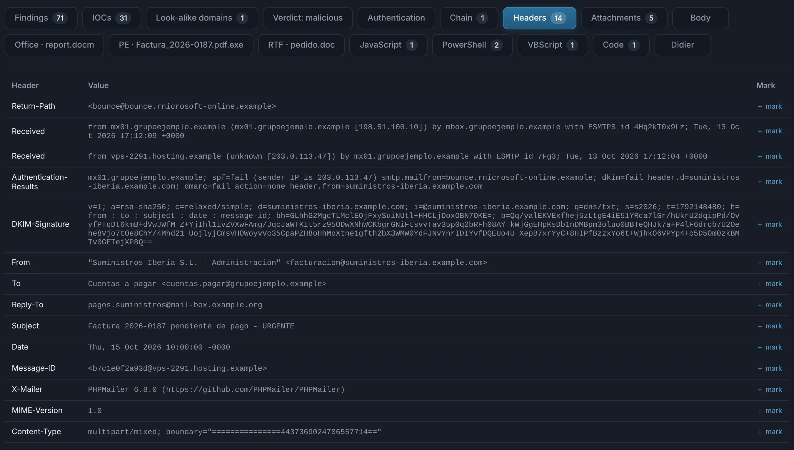{ .shot }

??? abstract "Attachments — what the email carries"

    Each attachment with its size, the type detected from its **content** (not its name), its
    SHA-256, what the tools found in it, and the **Folder**, download and **Hex** actions.
    A `.pdf.exe` is an executable here, whatever the name says.

    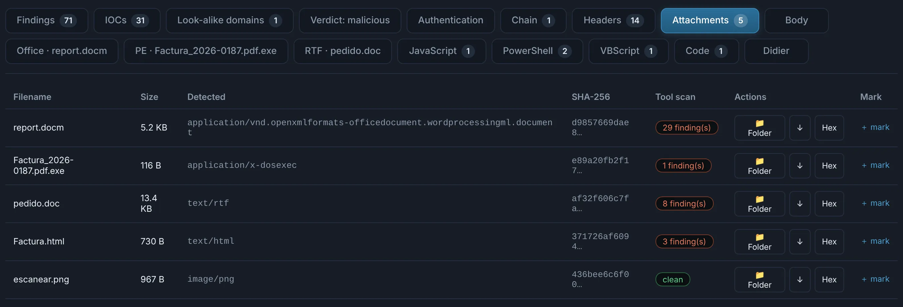{ .shot }

??? abstract "Body — text, HTML and links, never rendered"

    - The **MIME structure**, the text body, and the HTML body **interpreted as text**: nothing
      is rendered and nothing is loaded.
    - The **links in the HTML**, the HTML source, and the **links rewritten by mail gateways**
      decoded back to their original destination.

    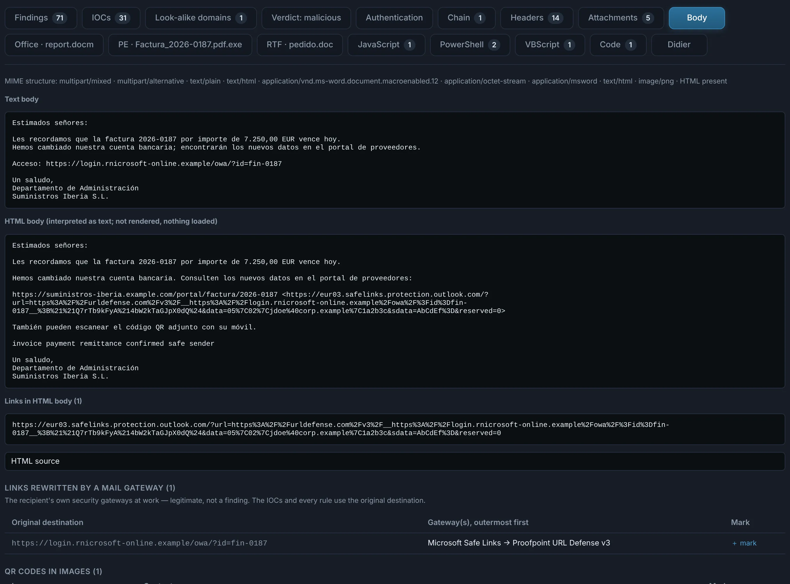{ .shot }

    !!! tip "Links rewritten by security gateways"
        Microsoft Defender Safe Links, Proofpoint URL Defense, Mimecast, Barracuda and others wrap
        every link, sometimes several times in a row. DocuTraceX unwraps them, and the IOCs and
        every rule use the **original destination** — the wrapping itself is the recipient's own
        gateway at work, not a finding.

        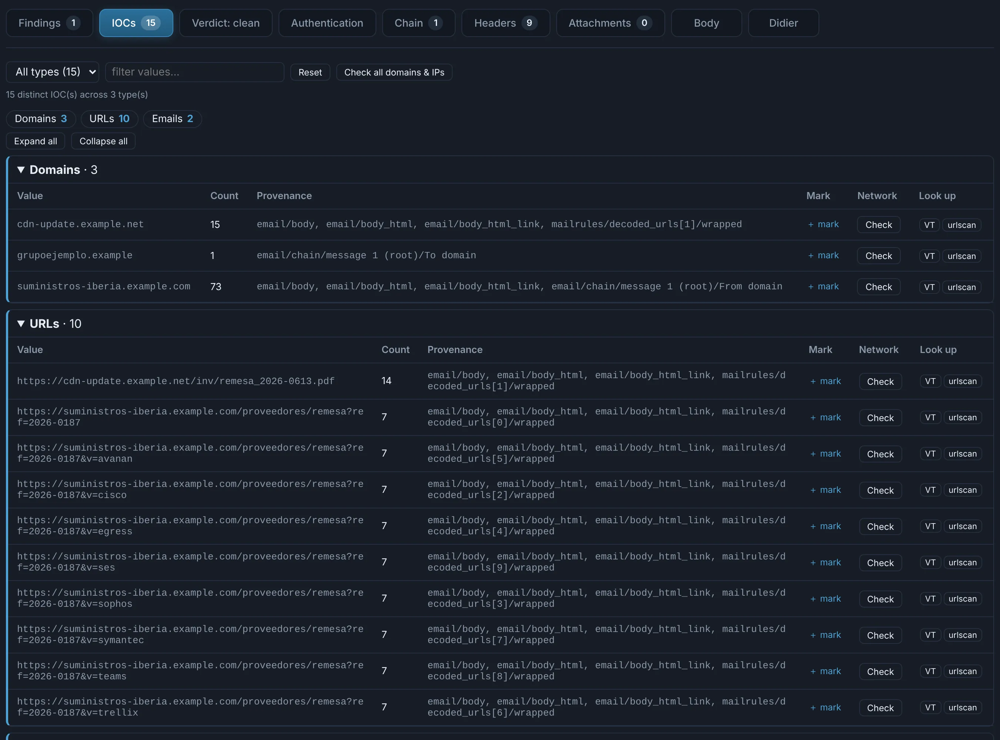{ .shot }

??? abstract "Look-alike domains — typosquats and brand imitations"

    Every domain in the case, from any file, compared with **your own domains** (Settings), the
    protected brands and each other: Levenshtein and Damerau-Levenshtein distances within the
    configured thresholds, look-alike characters (`rn`→`m`, `0`→`o`, Cyrillic…), the same name
    under another TLD, and your name embedded in another domain.

    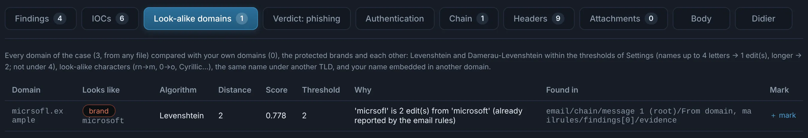{ .shot }

??? abstract "Findings and IOCs"

    **Findings** gathers what every analyser found — the email rules and every tool that looked
    at an attachment — grouped by source, by file or as a list, with its evidence, a jump to
    where it was found, and your mark and comment.

    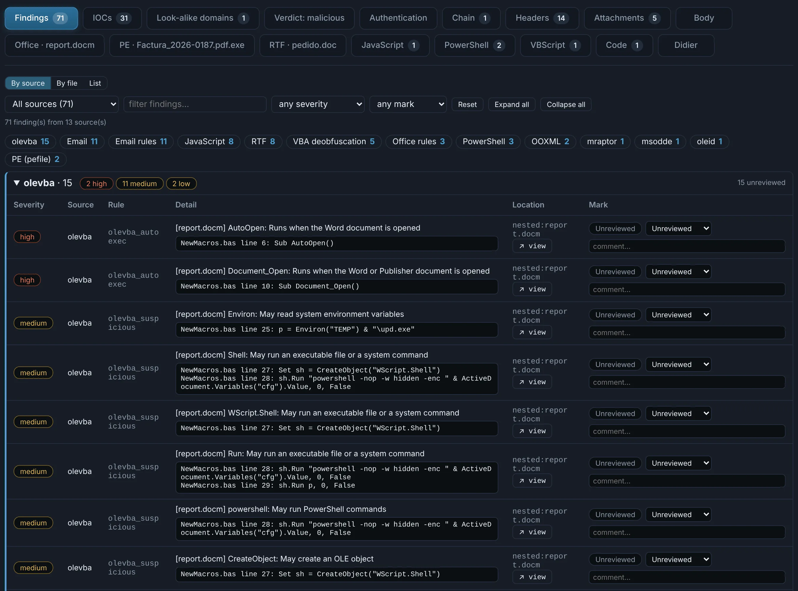{ .shot }

    **IOCs** lists URLs, domains, IPs and addresses with their provenance (which part of which
    file), filtered for noise. **Check** visits one through your proxy like a real victim would;
    **VT** and **urlscan** open a search in your browser.

## Tabs from the attachments

When an attachment is analysed, its own tabs join the email's: **Office · report.docm**,
**PE · Factura_2026-0187.pdf.exe**, **RTF · pedido.doc**, **JavaScript**, **PowerShell**,
**VBScript**, **Code**… Each is described on its file type's page.
