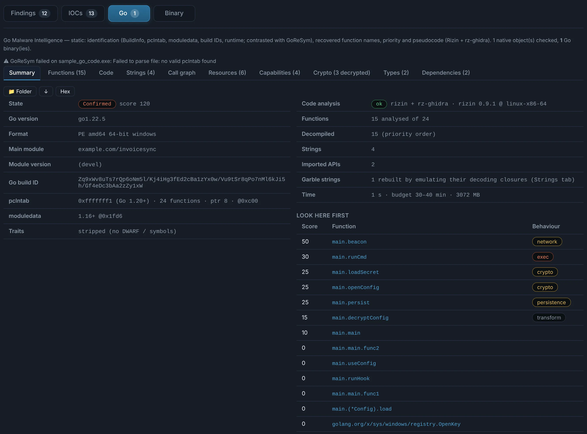

# Go

Go binaries — Windows, Linux or macOS — are recognised even stripped, and get a **Go** tab.

??? abstract "Go — build, functions, types and capabilities"

    - **Build**: Go version, main module, dependencies with versions, build settings, and the
      **build account and project folder** when the author left them in the paths.
    - **Functions get their names back** from the pclntab, with their **source file and line**;
      types, structures, interfaces and methods are rebuilt.
    - **Garble**: obfuscated builds are recognised (even without a pclntab), and their hidden
      strings are rebuilt by emulating only the decoding routines on a simulated CPU.
    - Embedded resources (`embed` files, certificates and keys) are recovered and analysed.
    - **Capabilities** (C2 channels, execution, injection, persistence, credential theft,
      ransomware-like encryption…) are reported only when the code backs them, with confidence
      and evidence — and frameworks such as Sliver, Merlin or Mythic agents are identified.

    { .shot }

The **Code** tab works on Go binaries like on any other: functions ranked by behaviour, with
pseudocode, disassembly and the call graph.
