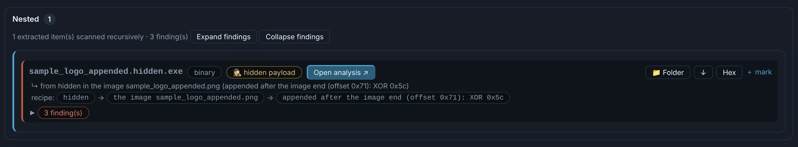
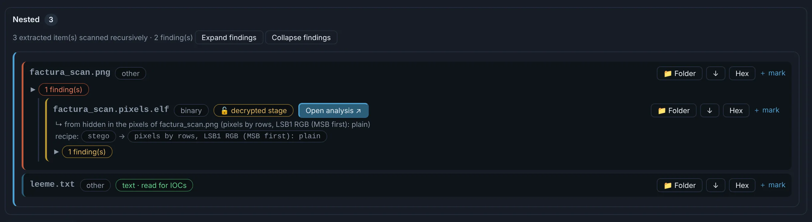

# Images

Every image that reaches a case — the file itself, an attachment, an archive entry, a resource,
Office or PDF media — is checked for a **hidden file**:

- data **appended after the end** of the image (after PNG's `IEND`, JPEG's `FFD9`, a GIF
  trailer or a BMP's declared size), as it is or XOR-ed;
- data **in the pixels**: bytes read by rows or columns in every channel order, and the low
  bits (LSB) — as they are, after a length, Base64, compressed, XOR-ed, or encrypted with the
  keys of the .NET assembly that carries the image, and with the key **recovered** from the
  structure of the file when it is not anywhere.

Only a well-formed file is kept (PE, ELF, ZIP, PDF, script…), cut to its real size, and it is
analysed as a nested child.

{ .shot }

{ .shot }

QR codes in images are decoded and their URLs join the IOCs.
