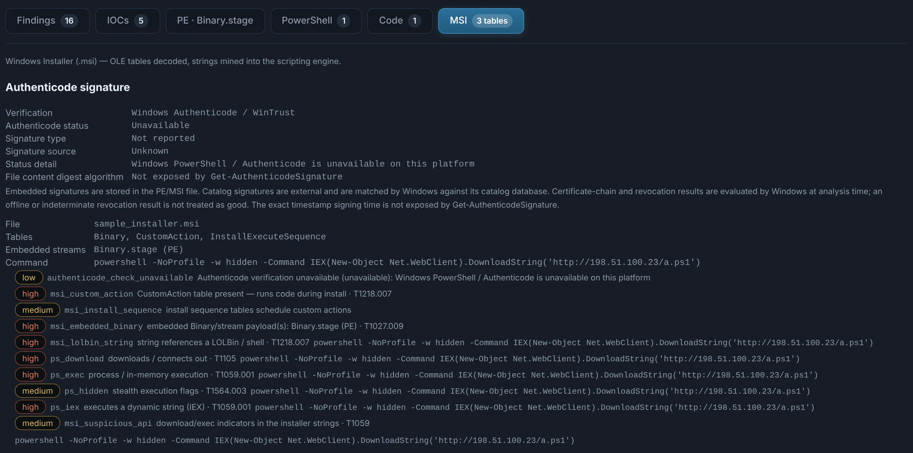

# Installers (MSI)

`.msi`, recognised by its streams even without an extension. A Windows Installer is a database:
what it runs is in its tables, and what it carries is in its streams.

The **MSI** tab lists the tables, decodes the mangled stream names, and flags the
**CustomAction** entries (scripts, embedded binaries, commands) with **when** they fire
(`InstallExecuteSequence`). Embedded binaries and cabinets are extracted and analysed
recursively — a trojanised installer that drops an RMM client or a loader shows it in
**Nested** — and the strings of `_StringData` (a PowerShell downloader in a custom action) go
through the scripting engine.

**The tables, read as rows.** The `CustomAction`, `Property`, `File`, `Binary`, `Shortcut` and
`Registry` tables are decoded (string pool, `_Columns`, each table column by column), so every
custom action says what it really runs: the executable a property points at, its arguments with
`[PROPERTY]` / `[#File]` references expanded, the file of the `File` table (and the stream it is
stored in). That replaces the old "the table exists" signals, which fired on every installer:

- the installer builder's own actions (Visual Studio, WiX, InstallShield, Advanced Installer: the
  `MSVBDPCADLL` prerequisite checks, folders, properties, error messages) are *info*;
- a VBScript / JScript custom action that works through the MSI `Session` (reads and writes the
  vendor's settings) caps its COM / WMI / registry findings at *medium* — a download, a decode or an
  external payload stays high;
- an EXE or a command line is *medium*, *high* with a LOLBin, a download or an encoded command;
- **an interpreter the package ships, run on a file it also ships** — `pythonw.exe InstallNotes.html`,
  `node.exe`, `javaw.exe`, `AutoIt3.exe`, `wscript.exe`, a renamed `mshta.exe`… — is
  *msi_embedded_interpreter* (high): a script in disguise, whatever its extension;
- **a Windows system library's name installed in the same folder as a program** (`version.dll`
  next to `App.exe`) is *msi_dll_sideloading*: medium, high when the installer also runs that
  program (DLL side-loading, T1574.002);
- **another MSI installed with msiexec while that payload runs** is *msi_decoy_installer* (high):
  the genuine installer as the decoy;
- Run keys written by the `Registry` table and shortcuts with a command line.

The `Icon.*.exe` streams are icons (Windows Installer names them after the shortcut's target), and
an embeddable Python's `python3xx.zip` is listed as the Python standard library, not analysed
module by module.

A file **padded** to hundreds of MB inside the installer or one of its cabinets (a small PE plus
one repeated byte, so scanners and size limits skip it) is still extracted: when a few huge
executables make the container expand far beyond its own size, they are **debloated** on the way
out and only the real binary is analysed (finding *installer_padded_file*, T1027.001). Anything
else over the limits is still refused, as a guard against archive bombs. Cabinets compressed with
LZX are read with 7-Zip.

{ .shot }

Other installers (Inno Setup, NSIS, WinRAR / 7-Zip SFX…) are unpacked from the
**Binary** tab of [Windows executables](windows-pe.md).
