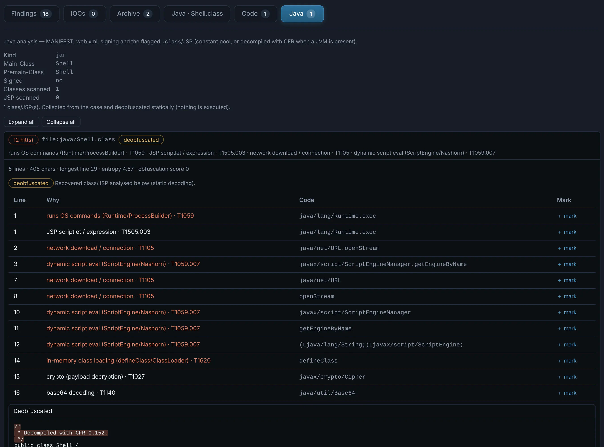

# Java

`.jar` `.war` `.ear` `.class` `.jsp`. Archives are extracted and every entry — nested jars
included — analysed; classes are read from their constant pool and decompiled (CFR) when it is
available.

The **Java** tab shows the **manifest** (`Main-Class`, and `Premain-Class` / `Agent-Class`: a
Java agent), signing, servlets and JSPs, and flags dangerous behaviour: command execution
(`Runtime.exec`, `ProcessBuilder`), reflection and class loading (`defineClass`), scripting
engines, JNDI lookups (Log4Shell), deserialization, cryptography and **webshells** (request
input reaching `exec`).

{ .shot }
