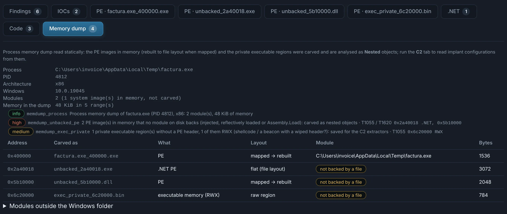
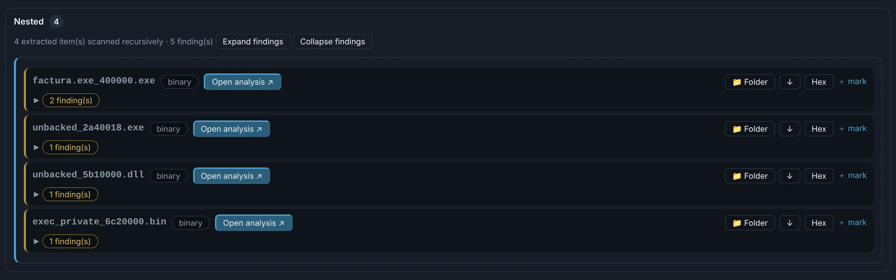

# Memory dumps

Windows **minidumps** (`.dmp`, the `MDMP` format: procdump, Task Manager's *Create dump file*,
WinDbg). When a crypter or protector cannot be undone statically, a dump of the process taken
**after it unpacked** already holds the payload in clear. You take the dump in your own lab VM;
DocuTraceX only reads the file.

The **Memory dump** tab shows the process (image, PID, architecture, Windows version), its
modules outside the Windows folder, and what was carved:

- **PE images in memory** — mapped ones rebuilt to file layout, flat ones (the `byte[]` handed
  to `Assembly.Load`) as they are — above all those **no module on disk backs**: injected,
  reflectively loaded or loaded from memory;
- **private executable memory without a PE header** — shellcode, a beacon whose header was
  wiped — saved for the C2 extractors.

{ .shot }

Every carved object is a nested child, analysed like any other file, and the
[C2](../engines/c2.md) tab reads implant configurations from them.

{ .shot }

!!! tip "Taking a useful dump"
    Run the sample, wait until it has unpacked (30–60 s), and take a **full** dump:
    `procdump -ma <pid>`. If it injects into another process (`RegAsm.exe`, `InstallUtil.exe`…),
    dump that one too. Mini dumps carry no memory.
