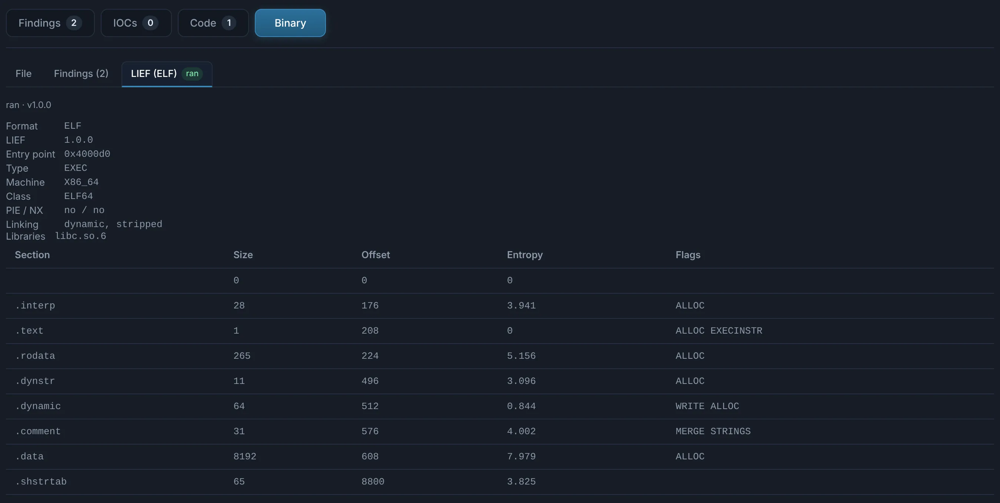
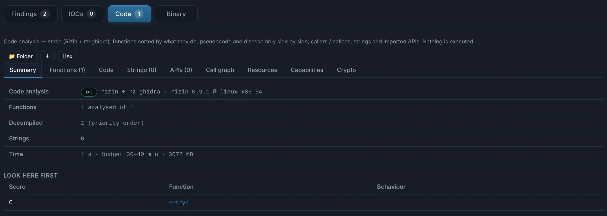

# Linux, macOS and Android

**ELF** and **Mach-O** binaries get the same static triage as Windows executables — header,
sections and entropy, imports and libraries, packers — plus the **Code** tab (functions,
pseudocode, call graph) and the [Go](go.md) tab when they are Go. A UPX-packed ELF or Mach-O
(common for Go implants and Linux bots) is unpacked with `upx -d` and the real binary is analysed
in **Nested**.

{ .shot }

{ .shot }

**APK** packages are extracted: their files and native libraries (one ELF
per ABI) are analysed as nested children, and the [Machine Learning](../engines/ml.md) tab
scores them with the EMBER2024 APK model.
