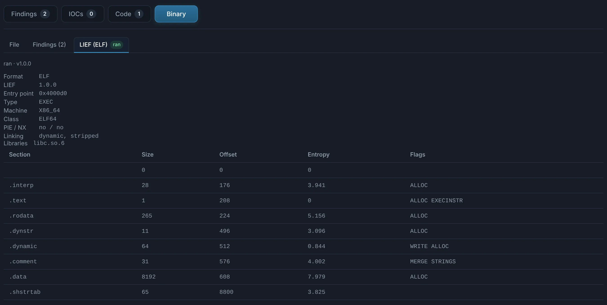
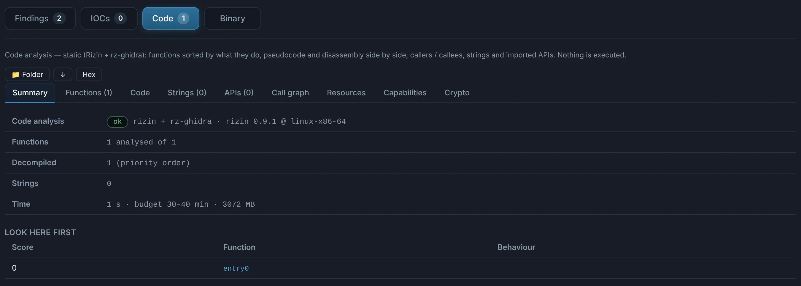

# Linux, macOS and Android

**ELF** and **Mach-O** binaries get the same static triage as Windows executables — header,
sections and entropy, imports and libraries, packers — plus the **Code** tab (functions,
pseudocode, call graph) and the [Go](go.md) tab when they are Go. A UPX-packed ELF or Mach-O
(common for Go implants and Linux bots) is unpacked with `upx -d` and the real binary is analysed
in **Nested**.

An ELF also gets **capa** (capabilities with ATT&CK, as for PE; in the background when it is
the case's own large binary). An ELF that does not say which OS it is for (no ABI note or
interpreter) is analysed as Linux, and the capa tab says so. Every ELF / Mach-O has a
**Strings** tab (printable ASCII / UTF-16LE, 6+ characters, up to 50,000): the IOCs are mined
from it, so a Linux binary has its IOCs even when the code analysis does not run; the code
analysis adds each string's function in Code → Strings. A **Rust** binary gets the Rust tab
(compiler, crates, build machine).

{ .shot }

{ .shot }

**APK** packages are extracted: their files and native libraries (one ELF
per ABI) are analysed as nested children, and the [Machine Learning](../engines/ml.md) tab
scores them with the EMBER2024 APK model.
