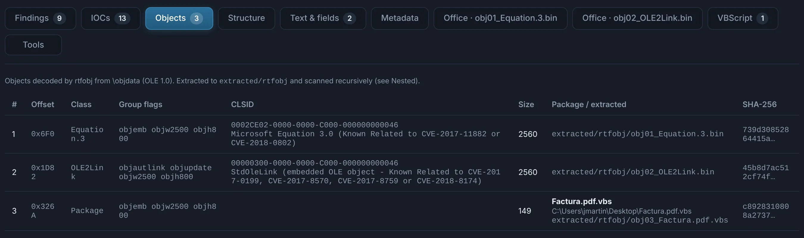
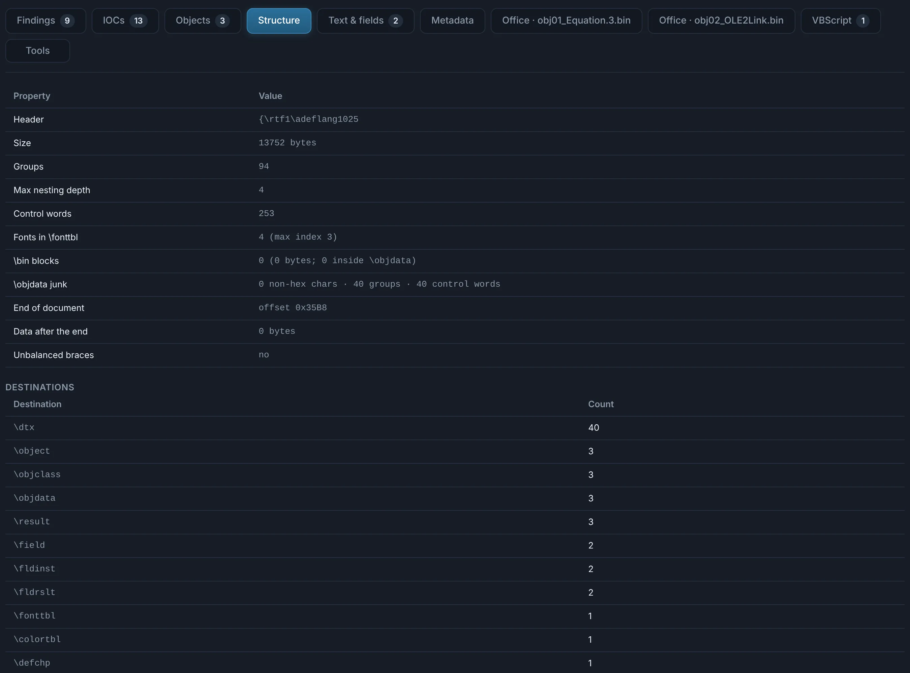
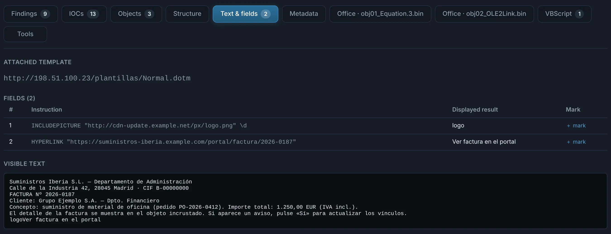
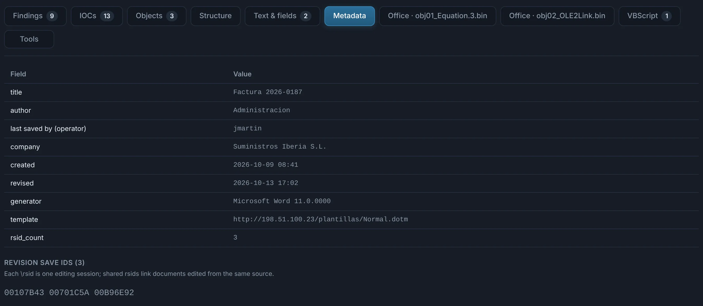

# RTF

`.rtf`, and anything whose content is RTF whatever its extension (the classic `.doc` that is
really RTF, so that Word opens it and the mail gateway's Office rules do not). RTF carries no
macros: its danger is in **embedded objects** and **fields**.

## Tabs

??? abstract "Objects — the embedded OLE objects"

    Every `\object` with its class, CLSID, size and flags: **Equation Editor** objects (and the
    junk around their shellcode), **OLE2Link** with `\objupdate` (fetches a remote document on
    open), **OLE Packages** with the file they carry. Each object is carved and analysed as a
    nested child; RTFScan's verdict is shown next to it.

    { .shot }

??? abstract "Structure — how the file is built"

    Header, groups and nesting depth, unbalanced braces, data after the end of the document,
    the destinations used (`\*\template`, `\objdata`…) and the counts of control words —
    obfuscated RTF shows up here as odd nesting, junk control words and data where it should not be.

    { .shot }

??? abstract "Text & fields — what it shows and what it fetches"

    The visible text, every **field** (`INCLUDEPICTURE`, `HYPERLINK`, `INCLUDETEXT`…) with its
    instruction and displayed result, the **attached template** (a remote `\*\template` is
    fetched when the document opens), document variables and user properties.

    { .shot }

??? abstract "Metadata — attribution"

    Author, operator, dates, generator and the **revision save ids** (rsids), which survive
    copy-paste between documents of the same author or kit.

    { .shot }
