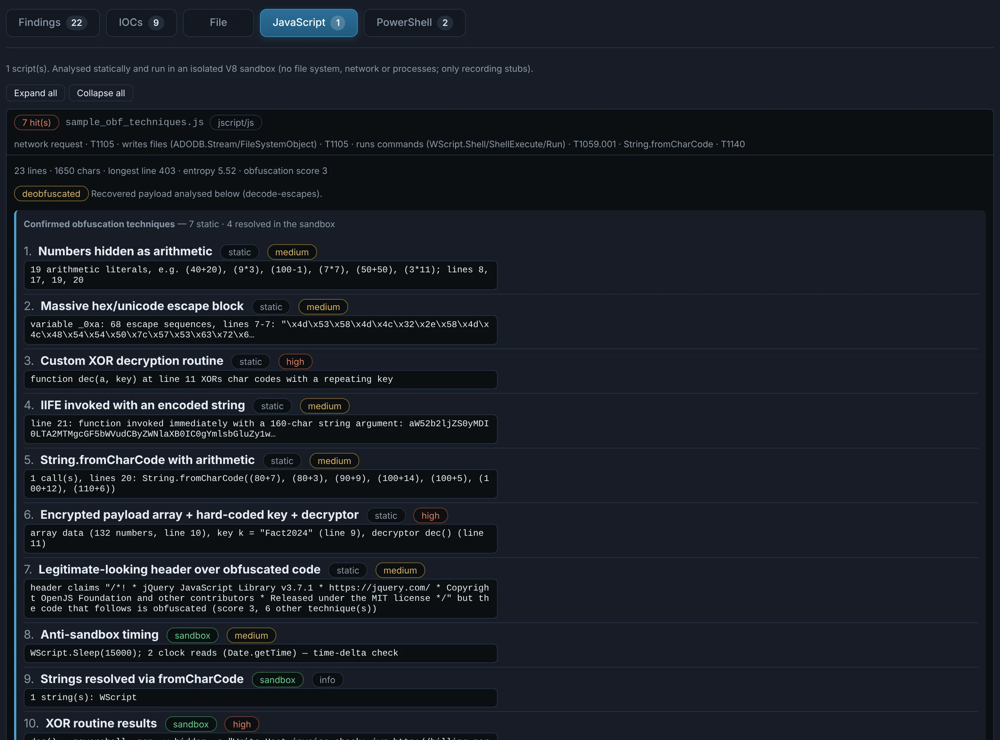
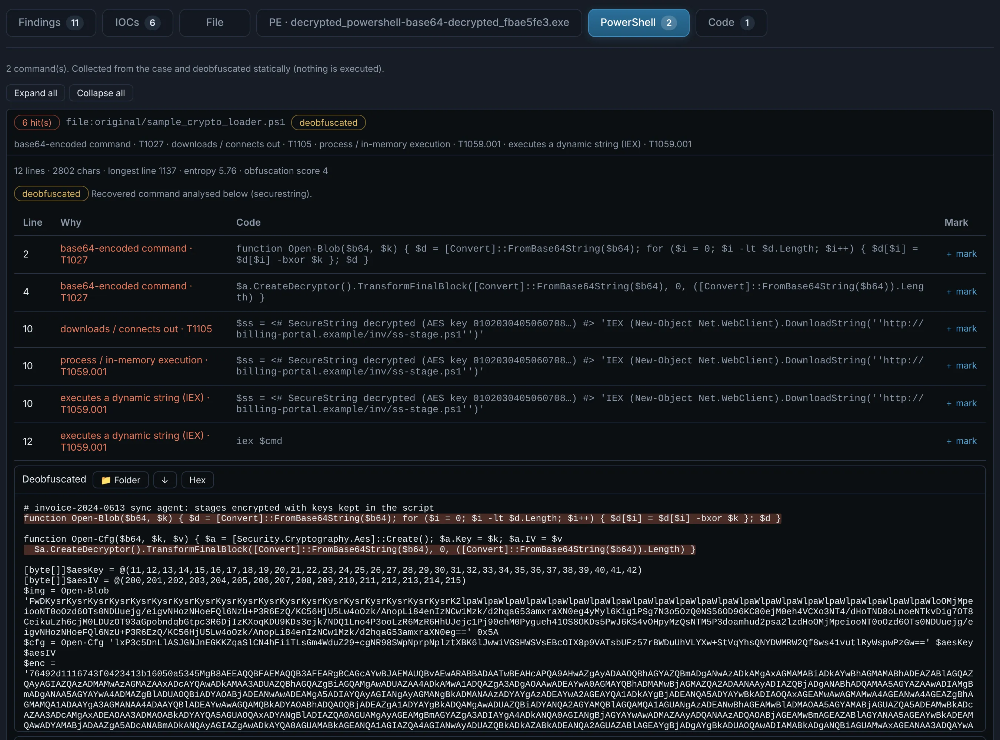
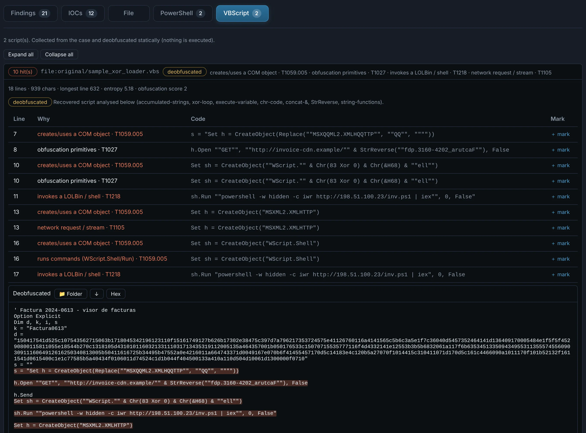
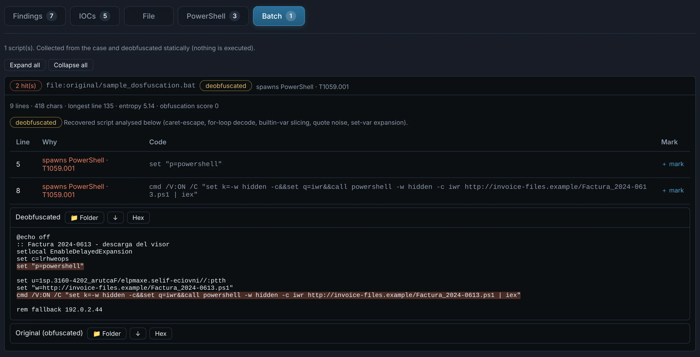
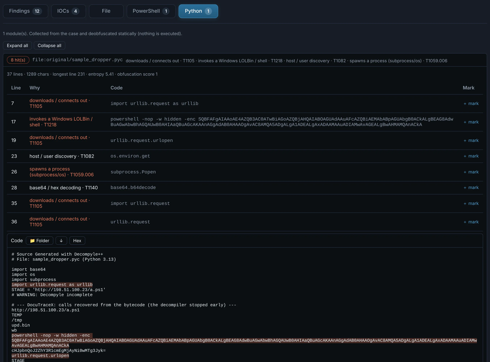

# Scripts

JavaScript / JScript (`.js` `.jse`), VBScript (`.vbs` `.vbe` `.wsf` `.wsc` `.sct`), HTA,
PowerShell (`.ps1` `.psm1`), batch (`.bat` `.cmd`) and Python (`.py` `.pyc`). The same engines
run on a script **wherever it hides**: a loose file, an email attachment, a macro, the command
of a shortcut, a PDF, an archive entry — and on the stages those scripts decode.

## How a script is analysed

1. **Deobfuscate first.** Encodings (Base64, hex, percent, char codes), XOR and compression
   layers, string tricks (concatenation, reversal, `replace`, format operators) and the usual
   obfuscators (obfuscator.io, JSFuck, Invoke-Obfuscation, DOSfuscation, PyArmor…) are peeled,
   layer by layer, with the recipe of each.
2. **Name the techniques.** The obfuscation techniques found are listed with their evidence.
3. **Sandbox.** JavaScript, VBScript and PowerShell also run in **isolated sandboxes** that only
   record what the script would do (downloads, files written, processes, registry) — nothing
   reaches the system or the network.
4. **Behaviour.** The clean code is matched against a behaviour catalogue (execution, download,
   persistence, defence evasion, injection, credential access, C2…) with ATT&CK techniques.
5. **Stages.** Every decoded or decrypted stage becomes a **nested child**, analysed by the
   engine that fits it — a JScript that drops a VBScript that runs PowerShell is followed to
   the end.

## Polyglots: a page that is also a program

An HTML page can be a program at the same time: the page sits where the language ignores it — a
Python triple-quoted string, a PowerShell `<# #>` comment, a `<!-- :` batch / HTA hybrid, a
`/* */` comment (JScript, AutoHotkey), Lua `--[[ ]]`, Ruby `=begin`, Perl `__END__` / POD,
AutoIt `#cs`, Tcl `if 0 { }`, a shell here-document, PHP blocks — and a portable interpreter
(`pythonw.exe notes.html`) runs the code around it. Whatever the file's extension, DocuTraceX
reports **an HTML page that is also a *language* program** (high when the code decodes, runs or
downloads), and the code — with the page replaced by a placeholder — becomes a nested child
analysed by that language's engine: layers peeled, the loader recognised, the payload carved.

AutoIt, AutoHotkey, Lua, Ruby, Perl, Tcl, shell, PHP and similar scripts have no engine of their
own: a **generic** one flags shellcode loaders (`DllCall` / ffi / Fiddle / Win32::API with
`VirtualAlloc`, `CallWindowProc`…), downloads, command execution, dynamic evaluation and
persistence, and hands their byte arrays and encoded literals to the stage carver.

These scripts are analysed the same way when they are **uploaded on their own** (`.au3`, `.ahk`,
`.lua`, `.rb`, `.pl`, `.tcl`, `.sh`, `.php`…). A **compiled AutoIt script** written without the
interpreter (`.a3x`: `AU3!EA05` / `EA06` blob) is recognised by its content whatever its name;
AutoIt-Ripper recovers the script (as it does for compiled AutoIt EXEs) and the generic engine
reads it. Next to it, a renamed `AutoIt3.exe` is still found by the *OriginalFilename* of its
version information (the same goes for the other portable interpreters).

**Shellcode with PEs inside.** When a loader's bytes are a short stub (`jmp` over a few bytes)
followed by PEs — a reflective loader DLL and the program it maps — each PE becomes its own
child, **cut to the size its headers give**. What lies after it (zeros, a repeated pattern,
word lists or CSS used to inflate the file past size limits) is left out and named in the
recipe, so only the real program is analysed.

## Tabs

??? abstract "JavaScript"

    { .shot }

??? abstract "PowerShell"

    Also folds the stages a loader decrypts with key material written in the script (XOR,
    AES with `[byte[]]` keys, GZIP / Deflate).

    { .shot }

??? abstract "VBScript"

    { .shot }

??? abstract "Batch"

    { .shot }

??? abstract "Python"

    Source, `exec` chains of public obfuscators, and byte-compiled `.pyc` (decompiled with pycdc
    when available, otherwise the calls and strings are rebuilt from the bytecode).

    { .shot }

!!! note "A text file of unknown type"
    goes through every script analyser too, so a dropper saved as `.txt` is not missed.
