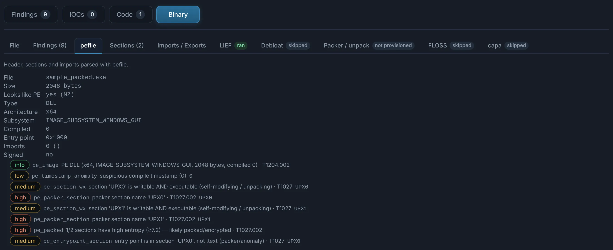
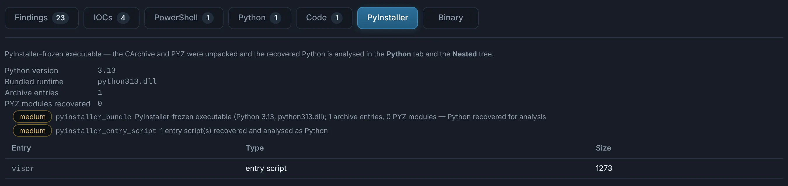

# Windows executables

`.exe` `.dll` `.scr` `.sys` `.cpl` `.ocx`… — and any file whose content is a PE. Nothing is
run: the binary is read, unpacked statically when it is packed or an installer, and its code
analysed.

## Tabs

??? abstract "Binary — static triage"

    - **Header and sections**: type, architecture, subsystem, timestamps, sections with their
      **entropy** and permissions (writable + executable), overlay, resources, version info,
      **signature** (Authenticode, trusted or not) and build artefacts (PDB path, Rich header),
      gathered with the imphash and the signer in a **Fingerprints** tab.
    - **Imports grouped by behaviour** (network, injection, crypto, persistence…) and exports
      (forwarders: proxy DLLs).
    - **Packers and installers** detected (Detect It Easy, signatures) and **unpacked**: UPX,
      Inno Setup (its `[Code]` script read too), NSIS, WinRAR / 7-Zip SFX, PyInstaller, Nuitka,
      AutoIt, Enigma Virtual Box…; protectors such as Themida, VMProtect or .NET virtualisers
      are named, with why their content cannot be read statically.
    - **Debloat**: padded binaries (hundreds of MB of zeros to evade scanners) are shrunk to
      their real size and analysed.
    - **FLOSS** strings (static, stack, decoded) and **capa** capabilities with ATT&CK. The
      automatic run skips FLOSS's *tight strings* (strings decrypted on the stack in a tight loop:
      FLOSS emulates every such loop, minutes to hours on large binaries); the code analysis
      runs them on its priority functions, and **Deep FLOSS** (Code view) on every function
      with **no time limit**, in the background, cancellable. The tools' time and status are
      sub-steps of the PE triage step in Tasks. `DOCUTRACEX_FLOSS_LARGE_MB=N` keeps tight
      strings in the automatic run for files up to N MB.
    - **Fast first, complete after.** Almost all of that analysis (34 of 38 min on a 6 MB
      x64 binary) is one pass that emulates every function to learn its calling convention.
      For the large binary's background FLOSS / capa it is left out (~10x faster: 3 min);
      measured on that binary, the stack strings were identical, while 2 decoded strings and
      1 capa match were missing and 1 decoded string was new. So a **complete analysis**
      follows in the background (Tasks: *complete analysis*) and **adds** what it finds:
      the result is the union of both. FLOSS tight on the priority functions uses the fast
      analysis; Deep FLOSS the complete one. `DOCUTRACEX_VIVISECT_FAST=0` turns it off.
    - While they run, Tasks shows their phase and progress (*analysing the binary*, *stack
      strings 1200/4800*, *decoded strings 3/20*, *matching rules*). If FLOSS hits its time
      limit, the strings it had found so far are **kept** (marked *PARTIAL* in the Binary tab)
      and reach Code → Strings, IOCs and Findings; a partial run is not cached.
    - **Rust tab** (`docutracex/rustmeta.py`): the source paths rustc leaves in clear give
      the compiler (`/rustc/<commit>/library/…` → version), the crates and their versions
      (`.cargo/registry/src/<index>/<crate>-<version>/`, git checkouts) with a role each
      (HTTP, TLS, encryption, string obfuscation, reconnaissance, capture, injection, chat
      C2…), the build machine's user (`C:\Users\<user>\.cargo`, `/home/<user>/`) and the
      project's own paths and name. Findings: `pe_rust_binary`, `pe_rust_crates_capabilities`,
      `pe_rust_build_user`. Not mined for IOCs (the strings themselves are).
    - **Rust** (and Go) binaries keep their strings back to back without a NUL: FLOSS's
      *language strings* split them (Rust: also the rustc version), and those are what is
      mined — the static string that merely glues several of them is left out. FLOSS's
      Rust support needs binary2strings (C++, no Windows wheel): `docutracex/b2s_compat.py`
      is the same algorithm in Python (MIT, ported from binary2strings 0.1.13).
    - FLOSS and capa share **one analysis of the binary**: the first of them to run saves
      it, and capa, FLOSS tight and Deep FLOSS of the same binary load it instead of
      analysing the binary again (much less time and memory on a large one).
    - **FLOSS in the background** for the case's own binary above 2 MB
      (`DOCUTRACEX_FLOSS_BACKGROUND_MB`, 0 = off): the case does not wait for it. **capa** of
      that binary goes to the background too (`DOCUTRACEX_CAPA_BACKGROUND=0` keeps it inline;
      a cached result runs inline): its capabilities and ATT&CK techniques reach the Binary tab
      and Findings when it ends, and the code analysis' capabilities are contrasted with it
      again then (capa column, *Only in capa*; code findings capa covers are dropped). These jobs always run in the app itself: an analysis
      running on the portable Python only requests them, and the app starts them when it ends. A restart of the app ends
      them: on the next start they show as *interrupted* (re-run the analysis). Each job is listed in Tasks with its time and Cancel; other tasks of the case
      (C2, YARA, ML) are not blocked by them. When FLOSS ends its strings are added to the Binary
      tab, to Code → Strings with their function, and the case's IOCs and findings are
      recomputed — marks stay. A file whose FLOSS result is cached runs inline (instant).
      The code analysis' FLOSS tight strings on its priority functions go to the background
      the same way, and the code step says live what it is doing (Rizin analysis,
      decompiling n/N, FLOSS) and for how long.

    { .shot }

??? abstract "Code — functions ranked by what they do"

    The functions of the binary (Rizin), ordered by behaviour — network, crypto, execution,
    injection, persistence — with **pseudocode and disassembly side by side**, callers and
    callees, the strings and imported APIs each one uses, a navigable **call graph** with the
    paths that lead to sensitive code, and each function's control flow. A **Crypto** view
    names the algorithms (constants, APIs) and decrypts statically what the file makes possible.

    { .shot }

??? abstract "PyInstaller and other bundles"

    Frozen Python executables are unpacked (CArchive, PYZ), their modules written back as `.pyc`
    and decompiled in the [Python](scripts.md) tab.

    { .shot }

Resources (`RT_RCDATA`, bitmaps, icons) are extracted; files hidden in them — Base64, XOR,
in the pixels of an image — become nested children. .NET and Go binaries get their own tabs:
see [.NET](dotnet.md) and [Go](go.md).
