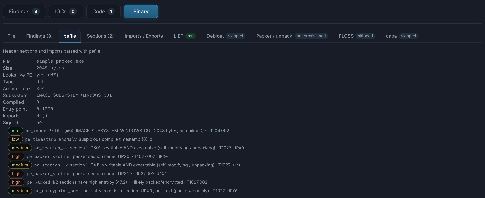
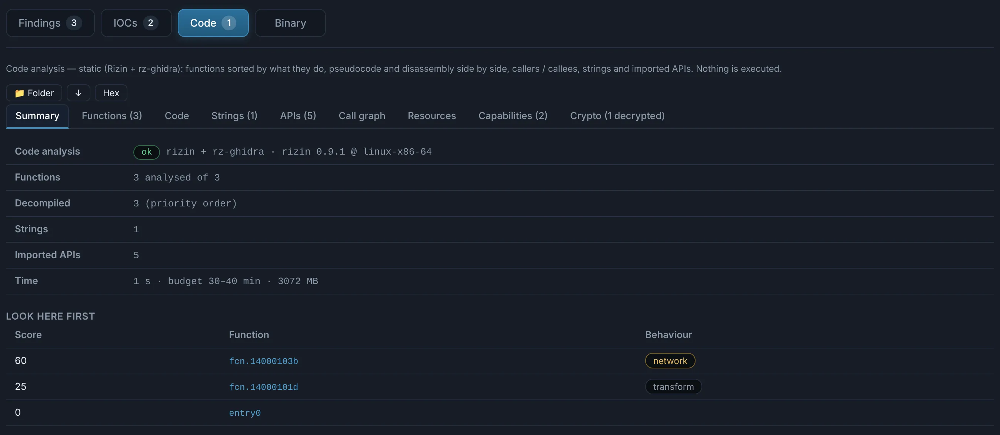
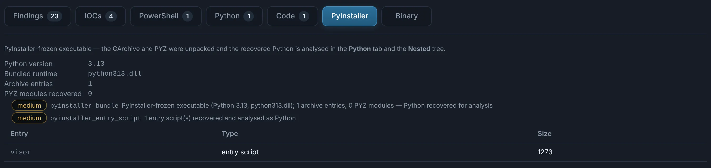

# Windows executables

`.exe` `.dll` `.scr` `.sys` `.cpl` `.ocx`… — and any file whose content is a PE. Nothing is
run: the binary is read, unpacked statically when it is packed or an installer, and its code
analysed.

## Tabs

??? abstract "Binary — static triage"

    - **Header and sections**: type, architecture, subsystem, timestamps, sections with their
      **entropy** and permissions (writable + executable), overlay, resources, version info,
      **signature** (Authenticode, trusted or not) and build artefacts (PDB path, Rich header),
      gathered with the imphash and the signer in a **Fingerprints** tab.
    - **Imports grouped by behaviour** (network, injection, crypto, persistence…) and exports
      (forwarders: proxy DLLs).
    - **Packers and installers** detected (Detect It Easy, signatures) and **unpacked**: UPX,
      Inno Setup (its `[Code]` script read too), NSIS, WinRAR / 7-Zip SFX, PyInstaller, Nuitka,
      AutoIt, Enigma Virtual Box…; protectors such as Themida, VMProtect or .NET virtualisers
      are named, with why their content cannot be read statically.
    - **Debloat**: padded binaries (hundreds of MB of zeros to evade scanners) are shrunk to
      their real size and analysed.
    - **FLOSS** strings (static, stack, tight, decoded) and **capa** capabilities with ATT&CK.

    { .shot }

??? abstract "Code — functions ranked by what they do"

    The functions of the binary (Rizin), ordered by behaviour — network, crypto, execution,
    injection, persistence — with **pseudocode and disassembly side by side**, callers and
    callees, the strings and imported APIs each one uses, a navigable **call graph** with the
    paths that lead to sensitive code, and each function's control flow. A **Crypto** view
    names the algorithms (constants, APIs) and decrypts statically what the file makes possible.

    { .shot }

??? abstract "PyInstaller and other bundles"

    Frozen Python executables are unpacked (CArchive, PYZ), their modules written back as `.pyc`
    and decompiled in the [Python](scripts.md) tab.

    { .shot }

Resources (`RT_RCDATA`, bitmaps, icons) are extracted; files hidden in them — Base64, XOR,
in the pixels of an image — become nested children. .NET and Go binaries get their own tabs:
see [.NET](dotnet.md) and [Go](go.md).
