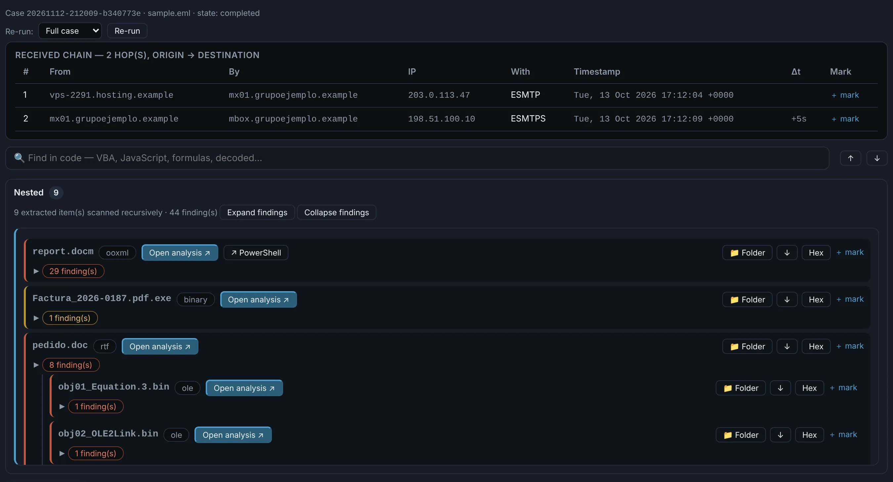

---
hide:
  - navigation
---

# DocuTraceX

**Static forensic analysis of malicious documents, emails, scripts and droppers — without opening them.**

Drop in a suspicious file — an email, an Office document, a PDF, a script, a shortcut, an archive,
an installer or an executable, even with no extension — and investigate it in the browser: what it
really is, what it would do, what it carries inside, and where it would connect.
**Nothing in the sample is ever executed.**

{ .shot }

-   :material-rocket-launch-outline:{ .lg .middle } **Getting started**

    ---

    Install it, run it, set up the proxy and your own domains, analyse your first sample.

    [:octicons-arrow-right-24: Getting started](getting-started.md) · [Configuration](configuration.md)

-   :material-file-document-multiple-outline:{ .lg .middle } **File types**

    ---

    [Email](file-types/email.md) · [Office](file-types/office.md) · [RTF](file-types/rtf.md) ·
    [PDF](file-types/pdf.md) · [OneNote and shortcuts](file-types/onenote-shortcuts.md) ·
    [Scripts](file-types/scripts.md) · [Java](file-types/java.md) · [MSI](file-types/installers.md) ·
    [Archives](file-types/archives.md) · [Images](file-types/images.md)

-   :material-chip:{ .lg .middle } **Binaries**

    ---

    [Windows executables](file-types/windows-pe.md) · [.NET](file-types/dotnet.md) ·
    [Go](file-types/go.md) · [Linux, macOS and Android](file-types/other-binaries.md) ·
    [Memory dumps](file-types/memdump.md)

-   :material-file-tree-outline:{ .lg .middle } **Registry**

    ---

    [Hives and .reg exports](file-types/registry.md): browse, search and SQL over a per-case
    database, rules, deleted entries recovered, decoded artifacts, the machine, a timeline.

-   :material-radar:{ .lg .middle } **Analysis tools**

    ---

    [Findings and IOCs](engines/findings-iocs.md) · [C2 / Beacons](engines/c2.md) ·
    [YARA](engines/yara.md) · [Machine Learning](engines/ml.md) · [Hex](engines/hex.md) ·
    [Network checks](engines/network-checks.md) · [Reports, AI and MCP](engines/reports.md)

-   :material-shield-check-outline:{ .lg .middle } **Static only**

    ---

    No macro, script, link or attachment is ever run by Office, a browser or the OS.
    Emulators and sandboxes are isolated, with time limits.

-   :material-earth-off:{ .lg .middle } **Offline unless you ask**

    ---

    The analysis never touches the network. Indicators are checked only when you press
    **Check**, through your proxy, with a fake victim identity.

## What every case gives you

| | |
|---|---|
| **Findings** | every analyser's findings with their evidence, grouped by source, by file or as a list, with your marks (TP / FP / Suspicious / Informational) and comments, preserved across re-analysis |
| **IOCs** | URLs, domains, IPs, emails, paths, registry keys, commands and hashes, filtered for noise, each with where it came from |
| **Nested** | everything inside the file — attachments, archive entries, embedded objects, unpacked binaries, decrypted stages — analysed in turn, many levels deep |
| **YARA · ML · C2 · Hex** | your rules on every object, a machine-learning second opinion, implant configurations, and a hex viewer that jumps to any offset |
| **Report** | a self-contained HTML report of what you confirmed, and a raw Markdown export for an LLM |
| **AI and MCP** | ask about the case through your AI provider, a local model or an MCP client — read-only |

!!! info "About the screenshots"
    Every picture on this site comes from the **inert samples** in `samples/samples.zip`
    (an invoice-fraud story with `*.example` domains and documentation IP ranges), taken by
    `python scripts/docs_screenshots.py`. None of them shows a real case.
