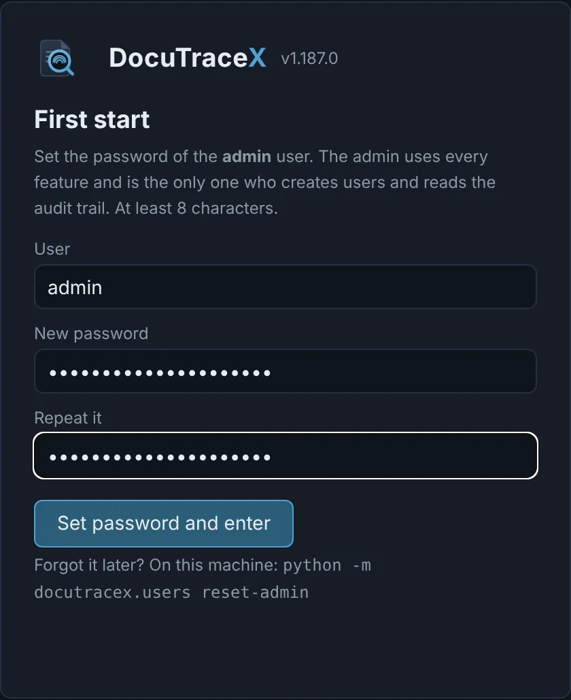
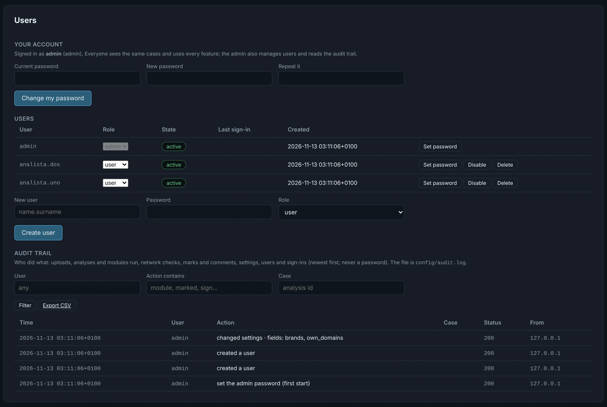

# Users, sign-in and audit

DocuTraceX is always behind a sign-in. Everyone signed in sees the same cases and uses every
feature; the **admin** also creates users, changes their passwords and reads the **audit trail**
of who did what.

## First start

The first time the app is opened — in any browser, from any machine — it asks for the password of
the **admin** user, and shows nothing else until it is set (at least 8 characters).

{ .shot width="420" }

After that, every visit starts at the **Sign in** page. Your name and **Sign out** are at the top
right of the app.

!!! tip "Forgot the admin password?"
    On the console of the machine that runs DocuTraceX (no web access needed):

    ```bash
    python -m docutracex.users reset-admin     # asks for the new password twice
    ```

    It also closes the admin's open sessions. `python -m docutracex.users list` lists the users.

## The Users tab

Next to **Settings**. Every user can change their own password there; the admin also sees the user
list and the audit trail.

{ .shot }

| | admin | user |
|---|:-:|:-:|
| Upload, analyse, run any module, mark findings and IOCs, comment, report | ✓ | ✓ |
| Settings, YARA rules, Diagnostics, delete cases | ✓ | ✓ |
| Change their own password | ✓ | ✓ |
| Create users, set their password, change their role, disable or delete them | ✓ | |
| Read and export the audit trail | ✓ | |
| Regenerate the MCP token | ✓ | |

- **Create user**: a name (letters, digits, `.` `-` `_` `@`), an initial password and the role.
- **Set password** / **Disable**: the user's open sessions are closed at once.
- **Delete** removes the account; the cases they uploaded and their marks stay.
- The `admin` account cannot be disabled, deleted or lose its role. More users can have the admin
  role.

## Audit trail

Every action that changes something is recorded with the time, the user, the action in plain
words, the case, a short detail and the client address:

- **uploads** (with the file name) and quick analyses;
- **analyses and modules run on demand** — full re-analysis, YARA, ML, C2, FLOSS, decompiling —
  with the module and how many objects;
- **network checks** (the indicator checked);
- **marks** (TP / FP / Suspicious / Informational) and **comments**, manual findings;
- **settings** (which fields changed, never their values), YARA rule changes, Diagnostics
  reinstalls, cancelled tasks, AI questions;
- **users**: created, changed, deleted; **sign-ins**, failed sign-ins and sign-outs.

Reading pages is not recorded, and **passwords, API keys and proxy credentials never are**. Each
case also records who uploaded it.

Filter by user, action or case in the **Users** tab (a case id opens the case) and **Export CSV**
for a ticket or a spreadsheet. The trail is the file `config/audit.log` (one JSON object per line,
appended only); it rotates at 20 MB, keeping five old files.

## Sessions and safety

- A session lasts **12 hours without activity** and survives restarts of the app.
- **Five wrong passwords** from one address lock sign-in from it for five minutes.
- Passwords are stored as salted **scrypt** hashes (`config/users.json`); sessions are stored by the
  hash of their token (`config/sessions.json`), so neither file signs anybody in.
- Every change sent to the app must come from its own page (a header the page adds, plus a
  SameSite cookie): another website cannot act with your session.
- These files live in `config/`, git-ignored and kept across updates.

## MCP over HTTP: the token

The MCP server over HTTP (for MCP clients on other machines, such as OpenCode or Claude Code)
requires its own **token** in every request: `Authorization: Bearer <token>`. How to get it, use it
and regenerate it: [Reports, AI and MCP](engines/reports.md#mcp-over-http-and-its-token).

The MCP server over **stdio** — started by a client on the same machine — needs no token.
